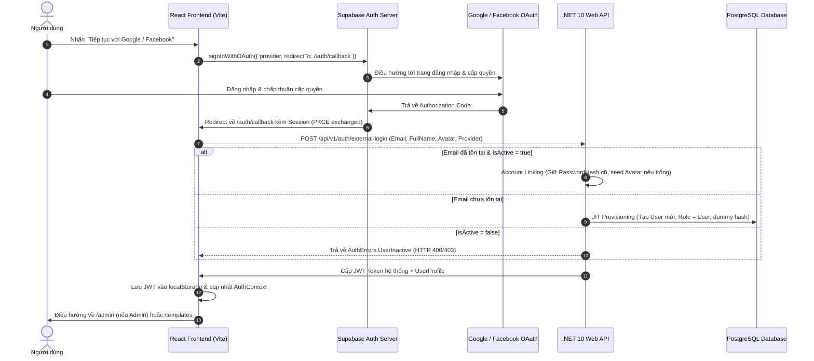

# KẾ HOẠCH RÀ SOÁT TÍNH NĂNG GOOGLE & FACEBOOK OAUTH VÀ XUẤT TÀI LIỆU HƯỚNG DẪN CẤU HÌNH CHI TIẾT

## CÂU HỎI CÒN BỎ NGỎ
Không có. Toàn bộ thông tin cấu hình hệ thống, luồng dữ liệu kiến trúc, các thông số môi trường (Local, Supabase, Render, Vercel, Google Cloud Console, Meta for Developers) đã được rà soát và xác định đầy đủ.

---

## 1. TỔNG QUAN VÀ GIẢI ĐÁP VẬN HÀNH SUPABASE OAUTH (GOOGLE & FACEBOOK)

### Supabase có hỗ trợ Google và Facebook OAuth không?
**CÓ, Supabase Auth hỗ trợ hoàn toàn và chính thức cả Google và Facebook (Meta) OAuth 2.0 / OIDC.**
Hệ thống sử dụng cơ chế bảo mật **PKCE Flow (Proof Key for Code Exchange)** đạt chuẩn bảo mật quốc tế cho Single Page Application (SPA / React).

### Cơ chế vận hành kiến trúc Hybrid (Supabase Auth Client + Custom .NET 10 Web API):


---

## 2. KẾT QUẢ RÀ SOÁT TOÀN DIỆN MÃ NGUỒN HIỆN CÓ

### 2.1. Backend (.NET 10 Clean Architecture)
- **Domain `User.cs`** (`BE/src/Domain/Entities/User.cs`):
  - Hỗ trợ phương thức factory `CreateExternal(...)` sinh mật khẩu dummy an toàn `EXTERNAL_{PROVIDER}_{GUID}` không thể giải mã/brute-force.
  - Phương thức `UpdateExternalProfile(fullName, avatarUrl, provider)`:
    - **Avatar Seeding**: Chỉ điền `AvatarUrl` nếu user chưa có avatar, không ghi đè nếu đã tồn tại.
    - **Account Linking**: Bảo toàn nguyên vẹn `PasswordHash` và `Role` hiện tại của tài khoản, cập nhật Provider và FullName hợp lý.
- **Contract** (`BE/src/Contract/Services/V1/Auth/Command.cs`, `Response.cs`):
  - `ExternalLoginCommand(Provider, Email, FullName, AvatarUrl, IdToken)` định nghĩa rõ ràng.
  - `AuthErrors.UserInactive`, `AuthErrors.InvalidProvider`, `AuthErrors.ExternalAuthFailed` đầy đủ.
- **Handler & Validator** (`BE/src/Application/UseCases/V1/Auth/`):
  - `ExternalLoginCommandHandler.cs`: Kiểm tra chuẩn hóa email (`.Trim().ToLowerInvariant()`), kiểm tra `!user.IsActive`, JIT Provisioning hoặc Account Linking, cấp JWT hệ thống qua `IJwtTokenGenerator`.
  - `ExternalLoginCommandValidator.cs`: Kiểm tra Provider chỉ thuộc `["Google", "Facebook"]`, email hợp lệ, độ dài cho phép.
- **Minimal API** (`BE/src/Presentation/APIs/Auth/AuthApi.cs`):
  - Định tuyến endpoint `POST /api/v1/auth/external-login` với đầy đủ Swagger OpenApi produces.
- **EF Core & Migration** (`BE/src/Persistence/`):
  - `UserConfiguration.cs`: Cấu hình độ dài `AvatarUrl` (500 chars), `Provider` (50 chars), QueryFilter loại bỏ soft-delete `!IsDeleted`.
  - Migration `20260923143000_AddAvatarAndProviderToUsers.cs` đã được sinh và sẵn sàng.
- **Test Suite Backend**: Toàn bộ 402 Unit Tests và 7 Architecture Tests đều chạy đạt 100% (Pass).

### 2.2. Frontend (React 18 + Vite + Tailwind CSS)
- **`FE/src/lib/supabaseClient.js`**:
  - *Điểm phát hiện cần fix*: Đang chỉ đọc `import.meta.env.VITE_SUPABASE_ANON_KEY`, trong khi file `FE/.env` đặt tên là `VITE_SUPABASE_PUBLISHABLE_KEY`. Cần chỉnh sửa để đọc fallback cả 2 biến nhằm tránh bị rơi về `'placeholder_anon_key'`.
- **`FE/src/api/authApi.js`**: Đã có `externalLogin(payload)` gọi đúng endpoint `/auth/external-login`.
- **`FE/src/contexts/AuthContext.jsx`**: Cung cấp `loginWithOAuth(provider)` và `handleOAuthCallback(session)`, tự động parse metadata từ Supabase (`full_name`, `avatar_url`, `picture`), đồng bộ với Backend và quản lý session trong `localStorage`.
- **`FE/src/components/auth/SocialAuthButtons.jsx`**: Nút bấm Google và Facebook với icon SVG chuẩn nhận diện thương hiệu, trạng thái spinner loading, disable chống click đúp.
- **`FE/src/pages/auth/LoginPage.jsx` & `RegisterPage.jsx`**: Nhúng `SocialAuthButtons` liền mạch phía trên form email/password truyền thống.
- **`FE/src/pages/auth/AuthCallbackPage.jsx`**: Bắt lỗi từ URL query/hash (`error`, `error_description`), lắng nghe `onAuthStateChange`, có timeout fallback 7s, hiển thị UI trạng thái loading/thành công/thất bại rõ ràng.
- **`FE/src/components/Navbar.jsx`**: Hiển thị avatar tròn của người dùng (từ Google/Facebook hoặc fallback chữ cái đầu), dropdown đăng xuất dọn dẹp cả session Supabase và token backend.
- **`FE/src/routes/index.jsx`**: Đã đăng ký route `/auth/callback`.
- **Test Suite Frontend Auth**: 19 tests trong `authContext.test.jsx` và `loginPage.test.jsx` đều chạy đạt 100% (Pass).

### 2.3. Secret Isolation & Gitignore
- `.gitignore` (Root) và `FE/.gitignore`: Đã cấu hình chặn `appsettings.Development.json`, `.env`, `.env.local`.
- Đã xác thực qua `git status`: Không có file chứa credentials thật nào bị đưa vào Git tracking.
- `appsettings.example.json` và `FE/.env.example` được giữ sạch làm khuôn mẫu cấu hình.

---

## 3. DANH SÁCH FILE CẦN TẠO MỚI HOẶC CẦN SỬA

| STT | Hành động | Đường dẫn file chính xác | Mục đích |
|---|---|---|---|
| 1 | **Sửa** | `FE/src/lib/supabaseClient.js` | Hỗ trợ đọc cả `VITE_SUPABASE_ANON_KEY` và `VITE_SUPABASE_PUBLISHABLE_KEY` |
| 2 | **Sửa** | `FE/.env.example` | Bổ sung hướng dẫn cả 2 biến `VITE_SUPABASE_ANON_KEY` và `VITE_SUPABASE_PUBLISHABLE_KEY` |
| 3 | **Tạo mới** | `_Docs/HUONG_DAN_CAU_HINH_OAUTH.md` | Hướng dẫn chi tiết step-by-step 4 môi trường/dịch vụ bằng tiếng Việt (Local, Render/Vercel, Google Console, Facebook Meta, Supabase Console) |
| 4 | **Tạo mới** | `_Docs/OAUTH_SETUP_GUIDE.md` | Tài liệu kỹ thuật cấu hình OAuth chuẩn quốc tế bằng tiếng Anh (English Version) |

---

## 4. CHỮ KÝ HÀM VÀ INTERFACE BẮT BUỘC

### 4.1. Frontend `FE/src/lib/supabaseClient.js`
```javascript
// Chữ ký xuất hiện trong supabaseClient.js:
export const supabase: SupabaseClient;
export const signInWithGoogle: () => Promise<{ data: { provider: string; url: string }; error: AuthError | null }>;
export const signInWithFacebook: () => Promise<{ data: { provider: string; url: string }; error: AuthError | null }>;
export const getSupabaseSession: () => Promise<Session | null>;
```
*Logic cải tiến*:
```javascript
const supabaseAnonKey =
  import.meta.env.VITE_SUPABASE_ANON_KEY ||
  import.meta.env.VITE_SUPABASE_PUBLISHABLE_KEY ||
  'placeholder_anon_key';
```

### 4.2. Backend Contracts & Handlers
- **Contract**:
  ```csharp
  public record ExternalLoginCommand(
      string Provider,
      string Email,
      string FullName,
      string? AvatarUrl = null,
      string? IdToken = null) : ICommand<LoginResponse>;
  ```
- **Handler**:
  ```csharp
  public sealed class ExternalLoginCommandHandler : ICommandHandler<ExternalLoginCommand, LoginResponse>
  {
      public Task<Result<LoginResponse>> Handle(ExternalLoginCommand request, CancellationToken cancellationToken);
  }
  ```
- **Domain**:
  ```csharp
  public static User CreateExternal(string email, string fullName, string? avatarUrl = null, string provider = "Google", string role = "User");
  public void UpdateExternalProfile(string? fullName, string? avatarUrl, string? provider = null);
  ```

---

## 5. CÁC TRƯỜNG HỢP BIÊN BẮT BUỘC PHẢI XỬ LÝ (EDGE CASES)

1. **Account Linking theo Email**:
   - Trường hợp: Người dùng đã đăng ký trước bằng Email/Mật khẩu hoặc qua Google, sau đó chọn đăng nhập bằng Facebook với cùng Email.
   - Xử lý: Tìm kiếm user theo normalized email (`email.Trim().ToLowerInvariant()`). Nếu thấy, KHÔNG được ghi đè hay làm mất `PasswordHash` ban đầu. Cập nhật `Provider` (nếu trước đó là "Local"), cấp JWT token thành công.
2. **Avatar Seeding không phá vỡ avatar tự tạo**:
   - Trường hợp: Người dùng đã có avatar riêng từ trước (tự upload hoặc chỉnh sửa).
   - Xử lý: `UpdateExternalProfile` chỉ gán avatar mới khi `AvatarUrl` hiện tại là rỗng (`string.IsNullOrWhiteSpace(AvatarUrl)`). Nếu đã có, giữ nguyên avatar cũ.
3. **FullName Fallback**:
   - Trường hợp: Một số tài khoản Facebook hoặc Google không cấu hình tên hiển thị đầy đủ, hoặc trả về null.
   - Xử lý: Fallback theo thứ tự ưu tiên: `full_name` -> `name` -> phần tiền tố của email (`email.Split('@')[0]`) -> mặc định `"Người dùng"`.
4. **Token Generation an toàn**:
   - Cấp JWT có đầy đủ Claims: `ClaimTypes.NameIdentifier` (User.Id), `ClaimTypes.Email`, `ClaimTypes.Role`, `ClaimTypes.Name`, `jti`.
5. **Role Assignment bảo tồn phân quyền**:
   - Tài khoản đăng ký mới qua OAuth luôn được cấp Role = `"User"`.
   - Đối với tài khoản hiện hữu đã có Role = `"Admin"`, quá trình đăng nhập qua OAuth TUYỆT ĐỐI KHÔNG hạ quyền xuống `"User"`.
6. **Active Check (Tài khoản bị vô hiệu hóa)**:
   - Nếu `user.IsActive == false`, từ chối ngay lập tức và trả về lỗi nghiệp vụ `AuthErrors.UserInactive` ("Tài khoản của bạn đã bị khóa."). Tuyệt đối không cấp JWT.
7. **User Cancels / Provider Error**:
   - Khi người dùng bấm "Cancel" trên màn hình ủy quyền Google/Facebook, Provider redirect về với tham số `error=access_denied`. `AuthCallbackPage.jsx` phải bắt lỗi ngay tại URL hash/search, hiển thị thông báo thân thiện và nút quay về trang Login.

---

## 6. QUY ƯỚC CẦN BÁM THEO (KÈM TÊN FILE MẪU ĐỂ COPY QUY ƯỚC)

1. **Cấu trúc Domain Entity & Aggregate Root**:
   - File mẫu: `BE/src/Domain/Entities/User.cs`
   - Quy tắc: Private constructor, Factory methods (`Create`, `CreateExternal`), encapsulation thông qua các method thay đổi trạng thái (`UpdateProfile`, `UpdateExternalProfile`).
2. **CQRS & MediatR Pattern**:
   - File mẫu: `BE/src/Application/UseCases/V1/Auth/Commands/LoginCommandHandler.cs`
   - Quy tắc: ICommandHandler trả về `Result<T>`, dùng `Result.Success` hoặc `Result.Failure`.
3. **FluentValidation**:
   - File mẫu: `BE/src/Application/UseCases/V1/Auth/Validators/LoginCommandValidator.cs`
   - Quy tắc: Kế thừa `AbstractValidator<T>`, định nghĩa RuleFor rõ ràng, thông báo lỗi tiếng Việt dễ hiểu.
4. **Minimal API Endpoints**:
   - File mẫu: `BE/src/Presentation/APIs/Auth/AuthApi.cs`
   - Quy tắc: Implement `IEndpoint`, map qua `IEndpointRouteBuilder`, chuẩn hóa response qua hàm helper `HandleResult`.
5. **Frontend API & Context**:
   - File mẫu: `FE/src/api/authApi.js` và `FE/src/contexts/AuthContext.jsx`
   - Quy tắc: Axios instance tập trung xử lý unwrap `.value`, AuthContext bọc toàn bộ App state, lưu trữ token an toàn trong localStorage.

---

## 7. BỐ CỤC CHI TIẾT CỦA FILE TÀI LIỆU `_Docs/HUONG_DAN_CAU_HINH_OAUTH.md`

Tài liệu cần tạo ra phải là cuốn cẩm nang triển khai hoàn chỉnh (Production-ready), bao gồm 7 phần cốt lõi:

1. **Tổng Quan Kiến Trúc & Sơ Đồ Khái Niệm**:
   - Luồng tương tác giữa React (PKCE) -> Supabase -> Identity Provider (Google/Meta) -> Backend .NET 10.
   - Vì sao kiến trúc này tối ưu bảo mật và không làm rò rỉ Client Secret.
2. **Cấu Hình Google Cloud Console (Step-by-Step)**:
   - Tạo Project mới trên Google Cloud Console.
   - Cấu hình màn hình đồng thuận OAuth (OAuth consent screen): Scopes (`.../auth/userinfo.email`, `.../auth/userinfo.profile`).
   - Tạo OAuth Client ID (Web Application):
     - **Authorized JavaScript origins**: `http://localhost:5173`, `https://<YOUR-PROJECT-REF>.supabase.co`, `https://<YOUR-VERCEL-DOMAIN>.vercel.app`
     - **Authorized redirect URIs**: `https://<YOUR-PROJECT-REF>.supabase.co/auth/v1/callback`
   - Lấy Client ID và Client Secret.
3. **Cấu Hình Meta for Developers (Facebook Login)**:
   - Tạo App trên Meta Developers (Loại: Người tiêu dùng / Doanh nghiệp).
   - Thêm sản phẩm **Facebook Login for Business** hoặc **Facebook Login**.
   - Cấu hình Cài đặt Facebook Login:
     - **Valid OAuth Redirect URIs**: `https://<YOUR-PROJECT-REF>.supabase.co/auth/v1/callback`
   - Chuyển App sang chế độ **Live** (Trực tiếp) và khai báo Privacy Policy URL.
   - Lấy App ID và App Secret.
4. **Cấu Hình Supabase Console**:
   - Điều hướng tới `Authentication` -> `Providers`.
   - Bật **Google**: Điền Client ID & Client Secret lấy từ Google Cloud.
   - Bật **Facebook**: Điền App ID & App Secret lấy từ Meta Developers.
   - Cấu hình `Authentication` -> `URL Configuration`:
     - **Site URL**: `https://<YOUR-VERCEL-DOMAIN>.vercel.app` (hoặc `http://localhost:5173` khi test local).
     - **Redirect URLs** (Wildcard & Exact):
       - `http://localhost:5173/**`
       - `http://localhost:5173/auth/callback`
       - `https://*.vercel.app/**`
       - `https://<YOUR-PRODUCTION-DOMAIN>/**`
5. **Cấu Hình Môi Trường Local Development**:
   - File cấu hình Backend: `BE/src/API/appsettings.Development.json` (Connection String Supabase DB, CORS allowed origins cho `http://localhost:5173`).
   - File cấu hình Frontend: `FE/.env` (VITE_API_BASE_URL, VITE_SUPABASE_URL, VITE_SUPABASE_ANON_KEY / VITE_SUPABASE_PUBLISHABLE_KEY).
   - Các lệnh khởi chạy song song Backend (`dotnet run`) và Frontend (`npm run dev`).
6. **Cấu Hình Môi Trường Production (Render & Vercel)**:
   - **Render (Backend)**: Thiết lập Environment Variables (`ConnectionStrings__DefaultConnection`, `Jwt__SecretKey`, `Cors__AllowedOrigins`).
   - **Vercel (Frontend)**: Thiết lập Environment Variables trong Project Settings (`VITE_API_BASE_URL`, `VITE_SUPABASE_URL`, `VITE_SUPABASE_ANON_KEY`).
   - Thiết lập cấu hình CORS hai đầu và DNS liên kết.
7. **Bảng Xử Lý Sự Cố Thường Gặp (Troubleshooting Guide)**:
   - Lỗi `redirect_uri_mismatch` (Lệch URI trong Google/Facebook Console hoặc Supabase).
   - Lỗi `Invalid API Key` hoặc 401 từ Supabase (Do sai/thiếu VITE_SUPABASE_ANON_KEY).
   - Lỗi `CORS policy: No 'Access-Control-Allow-Origin' header` từ Backend API.
   - Lỗi `Auth.UserInactive` khi tài khoản bị khóa trong DB.
   - Hướng dẫn kiểm tra Log chi tiết trên Supabase và Render.

---

## 8. TIÊU CHÍ NGHIỆM THU (ACCEPTANCE CRITERIA) CHO CHẶNG TRIỂN KHAI

1. [x] Không còn điểm mơ hồ, mục CÂU HỎI CÒN BỎ NGỎ ghi nhận "Không có".
2. [ ] File `FE/src/lib/supabaseClient.js` được cập nhật tương thích cả `VITE_SUPABASE_ANON_KEY` và `VITE_SUPABASE_PUBLISHABLE_KEY`.
3. [ ] File `FE/.env.example` được cập nhật đồng bộ.
4. [ ] File `_Docs/HUONG_DAN_CAU_HINH_OAUTH.md` được sinh ra với đầy đủ 7 mục chi tiết, chuyên nghiệp, có code snippet và sơ đồ minh họa.
5. [ ] File `_Docs/OAUTH_SETUP_GUIDE.md` được sinh ra bằng tiếng Anh tương ứng.
6. [ ] Toàn bộ unit tests BE (`dotnet test`) và FE (`npm test`) tiếp tục pass 100%.
7. [ ] Bàn giao kết quả rõ ràng qua `PromtAI/.gemini/results/plan.md`.
