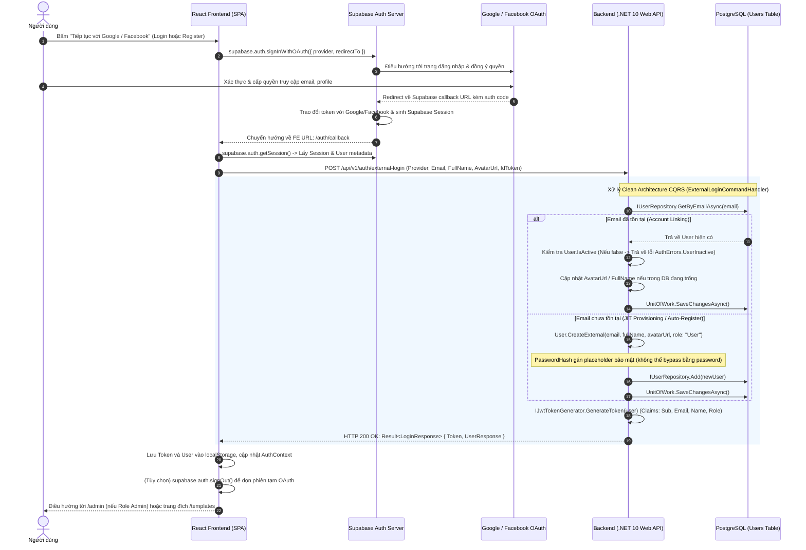

# KẾ HOẠCH TRIỂN KHAI XÁC THỰC GOOGLE & FACEBOOK OAUTH VỚI SUPABASE, .NET 10 CLEAN ARCHITECTURE VÀ REACT 19

---

## 1. CÂU HỎI CÒN BỎ NGỎ

Các thông số và cấu hình bên ngoài người dùng/DevOps cần cung cấp hoặc cấu hình trực tiếp trên các cổng quản trị bên thứ ba trước khi flow OAuth hoạt động trọn vẹn:

1. **Thông tin Supabase Project API (Frontend Env)**:
   - Database hiện tại đang kết nối qua chuỗi kết nối PostgreSQL Supabase (`aws-0-ap-southeast-1.pooler.supabase.com`). Tuy nhiên, Frontend cần 2 biến môi trường để gọi Supabase Auth SDK:
     - `VITE_SUPABASE_URL`: (VD: `https://womdjbjgsnokbntdidoc.supabase.co`)
     - `VITE_SUPABASE_ANON_KEY`: Public Anon Key lấy tại Supabase Dashboard -> **Project Settings** -> **API**.
   - *Cần xác nhận*: Bạn đã có `Anon Key` của dự án Supabase này chưa?

2. **Cấu hình Google Cloud Console (Google OAuth 2.0)**:
   - Đã tạo dự án trên [Google Cloud Console](https://console.cloud.google.com/) chưa?
   - Cần kích hoạt **OAuth consent screen** và tạo **OAuth 2.0 Client ID** loại **Web application**.
   - **Authorized redirect URI** bắt buộc phải khai báo chính xác URL callback của Supabase:
     `https://<project-ref>.supabase.co/auth/v1/callback`
   - Cần cấu hình `Client ID` và `Client Secret` này vào Supabase Dashboard -> **Authentication** -> **Providers** -> **Google** (bật Enable Provider).

3. **Cấu hình Meta for Developers (Facebook Login)**:
   - Đã tạo ứng dụng trên [Meta for Developers](https://developers.facebook.com/) chưa?
   - Thêm sản phẩm **Facebook Login for Business** (hoặc Consumer).
   - Khai báo **Valid OAuth Redirect URIs** trên Meta App:
     `https://<project-ref>.supabase.co/auth/v1/callback`
   - Cần cấu hình `App ID` và `App Secret` vào Supabase Dashboard -> **Authentication** -> **Providers** -> **Facebook** (bật Enable Provider).

4. **Whitelist Redirect URL trên Supabase**:
   - Trên Supabase Dashboard -> **Authentication** -> **URL Configuration**:
     - **Site URL**: `http://localhost:5173` (cho dev) hoặc domain production.
     - **Redirect URLs**: Cần thêm `http://localhost:5173/**`, `http://localhost:5173/auth/callback`, và các domain Vercel (`https://template-landing-page-*.vercel.app/**`).

5. **Mức độ bảo mật Token Verification ở Backend .NET 10**:
   - *Lựa chọn 1 (Khuyên dùng - Chuẩn Enterprise)*: Backend nhận `idToken` (hoặc Supabase access token) từ FE gửi lên, BE gọi xác thực với Supabase (hoặc verify JWT chữ ký với JWKS / Supabase JWT Secret) để đảm bảo email không thể bị giả mạo qua API call thủ công.
   - *Lựa chọn 2 (Đơn giản, tốc độ cao)*: Backend tin cậy payload từ Frontend do Frontend đã hoàn tất OAuth flow với Supabase SDK và bóc tách thông tin profile gửi lên endpoint `/api/v1/auth/external-login`.
   *(Bản kế hoạch này thiết kế kiến trúc hỗ trợ cả 2 lựa chọn, mặc định triển khai cơ chế xác thực an toàn qua IdToken/AccessToken).*

---

## 2. KHẢO SÁT & TRẢ LỜI: SUPABASE CÓ HỖ TRỢ GOOGLE VÀ FACEBOOK OAUTH KHÔNG?

### 2.1. Khẳng định
**CÓ, Supabase hỗ trợ toàn diện và nguyên bản (out-of-the-box) cả Google OAuth và Facebook OAuth**, cùng với hơn 20 nhà cung cấp OAuth khác (Apple, GitHub, Azure, Discord, Twitter...).

### 2.2. Cơ chế vận hành của Supabase OAuth
Supabase Auth hoạt động dựa trên máy chủ GoTrue mã nguồn mở, hỗ trợ chuẩn **OAuth 2.1 kết hợp PKCE (Proof Key for Code Exchange)** an toàn nhất hiện nay cho các ứng dụng Single Page Application (SPA như React):

1. **Khởi tạo OAuth (FE -> Supabase)**:
   Frontend gọi SDK `@supabase/supabase-js`:
   ```javascript
   await supabase.auth.signInWithOAuth({
     provider: 'google', // hoặc 'facebook'
     options: {
       redirectTo: `${window.location.origin}/auth/callback`,
     },
   });
   ```
2. **Ủy quyền & Trao đổi mã (Browser -> Provider -> Supabase)**:
   - Trình duyệt điều hướng sang màn hình đăng nhập của Google / Facebook.
   - Người dùng đăng nhập và nhấn "Đồng ý chia sẻ thông tin" (Email, Name, Avatar).
   - Google/Facebook redirect về endpoint callback của Supabase (`https://<project-ref>.supabase.co/auth/v1/callback?code=...`).
   - Supabase server đứng giữa thực hiện trao đổi Authorization Code lấy Token của Google/Facebook, tự động tạo/cập nhật bản ghi người dùng trong schema `auth.users` của Supabase.
3. **Phản hồi về Frontend**:
   - Supabase redirect người dùng về trang callback của ứng dụng React: `http://localhost:5173/auth/callback`.
   - Thư viện `@supabase/supabase-js` tự động phân giải token/code từ hash fragment hoặc query param, thiết lập `Session` chứa Supabase Access Token và metadata (`email`, `full_name`, `avatar_url`, `picture`).

---

## 3. PHÂN TÍCH GIẢI PHÁP KIẾN TRÚC TỔNG THỂ (AUTH & AUTHOR)

### 3.1. Đặc thù hệ thống & Kiến trúc Hybrid (Lai)
- **Kiến trúc hiện tại**: Backend là ASP.NET Core (.NET 10) Clean Architecture, cơ sở dữ liệu PostgreSQL (Supabase DB) lưu trữ nghiệp vụ trong bảng `Users`. Hệ thống đang tự quản lý phiên bằng **JWT Bearer Token** riêng (`IJwtTokenGenerator`, secret key cấu hình trong `appsettings.json`, thời hạn 24h, claims `sub` = UserId dạng `Guid`, `email`, `name`, `role`).
- **Authorization**: Role-based với 2 quyền `"Admin"` và `"User"`. Các API quản trị yêu cầu quyền Admin, còn trang cá nhân yêu cầu Bearer token.
- **Giải pháp Hybrid chuẩn**:
  - **Frontend** dùng Supabase Client làm gateway trung gian kết nối mạng xã hội (Google / Facebook) để tận dụng luồng OAuth PKCE không cần viết code OAuth phức tạp ở Backend.
  - **Backend .NET 10** tiếp nhận kết quả từ Supabase thông qua CQRS Endpoint `POST /api/v1/auth/external-login`. Backend đóng vai trò là **Source of Truth** duy nhất: kiểm tra email trong bảng `Users`, tự động liên kết tài khoản (Account Linking), tự động tạo tài khoản (JIT Provisioning) với vai trò `"User"`, cập nhật FullName / AvatarUrl nếu chưa có, và cấp **JWT Token chuẩn của hệ thống**.
  - **Frontend** sau đó sử dụng JWT do Backend cấp để gọi toàn bộ các API nghiệp vụ (`/api/v1/customizations`, `/api/v1/templates`, `/api/v1/auth/me`...) hoàn toàn đồng nhất với tài khoản đăng nhập email/mật khẩu truyền thống!

### 3.2. Sơ đồ tuần tự (Sequence Diagram)



---

## 4. QUY ƯỚC CẦN BÁM THEO & CÁC FILE MẪU

Coder khi triển khai cần tuân thủ triệt để các quy ước đã thiết lập sẵn trong codebase:

1. **CQRS & MediatR Pattern**:
   - Định nghĩa Request ở thư mục `Contract/Services/V1/Auth/Command.cs` kế thừa `ICommand<LoginResponse>` hoặc `IQuery<T>`.
   - File mẫu copy quy ước: [BE/src/Contract/Services/V1/Auth/Command.cs](file:///e:/Code/TemplateLandingPage/BE/src/Contract/Services/V1/Auth/Command.cs)
2. **Result Pattern & Domain Errors**:
   - Sử dụng `Result<T>.Success(data)` hoặc `Result.Failure<T>(AuthErrors.SomeError)`.
   - Tuyệt đối không throw Exception cho các lỗi nghiệp vụ dự đoán trước được (như User Inactive, Invalid Provider).
   - File mẫu copy quy ước: [BE/src/Application/UseCases/V1/Auth/Commands/LoginCommandHandler.cs](file:///e:/Code/TemplateLandingPage/BE/src/Application/UseCases/V1/Auth/Commands/LoginCommandHandler.cs) và [BE/src/Contract/Services/V1/Auth/Response.cs](file:///e:/Code/TemplateLandingPage/BE/src/Contract/Services/V1/Auth/Response.cs)
3. **FluentValidation Pipeline**:
   - Các Command đều có Validator tương ứng kế thừa `AbstractValidator<TCommand>` đặt tại thư mục `Validators`.
   - File mẫu copy quy ước: [BE/src/Application/UseCases/V1/Auth/Validators/LoginCommandValidator.cs](file:///e:/Code/TemplateLandingPage/BE/src/Application/UseCases/V1/Auth/Validators/LoginCommandValidator.cs)
4. **Minimal APIs Endpoint Mapping**:
   - Kế thừa `IEndpoint`, map qua `MapGroup("/api/v1/auth")`, dùng helper private `HandleResult`.
   - File mẫu copy quy ước: [BE/src/Presentation/APIs/Auth/AuthApi.cs](file:///e:/Code/TemplateLandingPage/BE/src/Presentation/APIs/Auth/AuthApi.cs)
5. **Entity Encapsulation (Domain-Driven Design)**:
   - Private setter cho các property của Entity, khởi tạo qua static factory method `Create(...)` hoặc `CreateExternal(...)`, cập nhật trạng thái qua domain methods.
   - File mẫu copy quy ước: [BE/src/Domain/Entities/User.cs](file:///e:/Code/TemplateLandingPage/BE/src/Domain/Entities/User.cs)
6. **Frontend State & Axios Pattern**:
   - API client bọc `axiosInstance`, trích xuất `response.data?.value ?? response.data`.
   - Quản lý auth state tập trung tại `AuthContext.jsx`.
   - File mẫu copy quy ước: [FE/src/api/authApi.js](file:///e:/Code/TemplateLandingPage/FE/src/api/authApi.js) và [FE/src/contexts/AuthContext.jsx](file:///e:/Code/TemplateLandingPage/FE/src/contexts/AuthContext.jsx)
7. **Unit Test Convention**:
   - Sử dụng xUnit, Moq, FluentAssertions theo cấu trúc Arrange - Act - Assert.
   - File mẫu copy quy ước: [BE/test/UnitTests/Application/Auth/LoginCommandHandlerTests.cs](file:///e:/Code/TemplateLandingPage/BE/test/UnitTests/Application/Auth/LoginCommandHandlerTests.cs)

---

## 5. DANH SÁCH FILE CẦN TẠO MỚI HOẶC SỬA ĐỔI

### 5.1. Backend (.NET 10)

| STT | File Path | Loại | Mục đích |
|---|---|---|---|
| 1 | `BE/src/Domain/Entities/User.cs` | Sửa | Thêm `AvatarUrl`, `Provider`, factory method `CreateExternal(...)`, method `UpdateExternalProfile(...)`. |
| 2 | `BE/src/Contract/Services/V1/Auth/Command.cs` | Sửa | Bổ sung `ExternalLoginCommand`. |
| 3 | `BE/src/Contract/Services/V1/Auth/Response.cs` | Sửa | Bổ sung `AvatarUrl` vào `UserResponse`; bổ sung `AuthErrors.InvalidProvider`, `AuthErrors.ExternalAuthFailed`. |
| 4 | `BE/src/Application/UseCases/V1/Auth/Commands/ExternalLoginCommandHandler.cs` | **Tạo mới** | Handler xử lý logic OAuth: Tra cứu email, Account Linking, Auto-seeding, Active check, cấp JWT token. |
| 5 | `BE/src/Application/UseCases/V1/Auth/Validators/ExternalLoginCommandValidator.cs` | **Tạo mới** | Validate Provider ("Google" \| "Facebook"), Email hợp lệ, FullName không rỗng. |
| 6 | `BE/src/Application/UseCases/V1/Auth/Commands/LoginCommandHandler.cs` | Sửa | Cập nhật ánh xạ `UserResponse` có thêm tham số `AvatarUrl`. |
| 7 | `BE/src/Application/UseCases/V1/Auth/Queries/GetCurrentUserQueryHandler.cs` | Sửa | Cập nhật ánh xạ `UserResponse` có thêm tham số `AvatarUrl`. |
| 8 | `BE/src/Application/UseCases/V1/Users/Queries/GetUsersQueryHandler.cs` | Sửa | Cập nhật ánh xạ `UserResponse` có thêm tham số `AvatarUrl`. |
| 9 | `BE/src/Application/UseCases/V1/Users/Queries/GetUserByIdQueryHandler.cs` | Sửa | Cập nhật ánh xạ `UserResponse` có thêm tham số `AvatarUrl`. |
| 10 | `BE/src/Presentation/APIs/Auth/AuthApi.cs` | Sửa | Đăng ký endpoint `POST /api/v1/auth/external-login`. |
| 11 | `BE/src/Persistence/Configurations/UserConfiguration.cs` | Sửa | Cấu hình EF Core property: `AvatarUrl` (max length 500, nullable), `Provider` (max length 50, nullable). |
| 12 | `BE/src/Persistence/Migrations/<timestamp>_AddAvatarAndProviderToUsers.cs` | **Tạo mới** | EF Core Migration thêm 2 cột `AvatarUrl` và `Provider` vào bảng `Users`. |
| 13 | `BE/test/UnitTests/Application/Auth/ExternalLoginCommandHandlerTests.cs` | **Tạo mới** | Unit test cho các kịch bản: New User Seed, Existing User Linking, User Inactive, Invalid Provider. |
| 14 | `BE/test/UnitTests/Application/Auth/ExternalLoginCommandValidatorTests.cs` | **Tạo mới** | Unit test cho validator `ExternalLoginCommandValidator`. |
| 15 | `BE/test/UnitTests/Application/Behaviors/ValidationPipelineBehaviorTests.cs` | Sửa | Cập nhật constructor `UserResponse` trong mock test dữ liệu. |

### 5.2. Frontend (React 19)

| STT | File Path | Loại | Mục đích |
|---|---|---|---|
| 1 | `FE/package.json` | Sửa | Thêm thư viện `@supabase/supabase-js` vào dependencies. |
| 2 | `FE/.env.example` | **Tạo mới** | File mẫu hướng dẫn khai báo `VITE_SUPABASE_URL`, `VITE_SUPABASE_ANON_KEY`, `VITE_API_BASE_URL`. |
| 3 | `FE/src/lib/supabaseClient.js` | **Tạo mới** | Khởi tạo Supabase client singleton và các helper: `signInWithGoogle()`, `signInWithFacebook()`, `getSupabaseSession()`. |
| 4 | `FE/src/api/authApi.js` | Sửa | Thêm method `externalLogin(payload)` gọi tới `/auth/external-login`. |
| 5 | `FE/src/contexts/AuthContext.jsx` | Sửa | Thêm hàm `loginWithOAuth(provider)`, `handleExternalCallback(session)` để lưu token/profile vào state và localStorage. |
| 6 | `FE/src/pages/auth/AuthCallbackPage.jsx` | **Tạo mới** | Trang hứng redirect sau khi đăng nhập mạng xã hội, lấy session Supabase, gọi BE external-login, điều hướng về đích. |
| 7 | `FE/src/pages/auth/LoginPage.jsx` | Sửa | Thêm 2 nút bấm mạng xã hội "Tiếp tục với Google" và "Tiếp tục với Facebook" kèm icon thương hiệu SVG chuẩn. |
| 8 | `FE/src/pages/auth/RegisterPage.jsx` | Sửa | Thêm 2 nút bấm mạng xã hội "Đăng ký với Google" và "Đăng ký với Facebook" (cùng kích hoạt JIT flow). |
| 9 | `FE/src/routes/index.jsx` | Sửa | Đăng ký route `<Route path="/auth/callback" element={<AuthCallbackPage />} />`. |
| 10 | `FE/src/components/Navbar.jsx` | Sửa | Hiển thị avatar ảnh thật (`user.avatarUrl`) trong dropdown profile thay vì chỉ chữ cái đầu nếu có ảnh. |

---

## 6. CHỮ KÝ HÀM & CONTRACT INTERFACES CHI TIẾT

### 6.1. Domain: `BE/src/Domain/Entities/User.cs`
```csharp
public sealed class User : AggregateRoot<Guid>, IAuditableEntity, ISoftDelete
{
    public string Email { get; private set; } = string.Empty;
    public string PasswordHash { get; private set; } = string.Empty;
    public string FullName { get; private set; } = string.Empty;
    public string Role { get; private set; } = "User"; // "Admin", "User"
    public string? AvatarUrl { get; private set; }
    public string? Provider { get; private set; } = "Local"; // "Local", "Google", "Facebook"
    public bool IsActive { get; private set; } = true;
    public bool IsDeleted { get; set; }
    public DateTime? DeletedAtUtc { get; set; }
    public DateTime CreatedAtUtc { get; set; }
    public DateTime? ModifiedAtUtc { get; set; }

    // Factory method cho OAuth/External User
    public static User CreateExternal(
        string email,
        string fullName,
        string? avatarUrl = null,
        string provider = "Google",
        string role = "User")
    {
        if (string.IsNullOrWhiteSpace(email))
            throw new ArgumentException("Email cannot be empty.", nameof(email));
        if (string.IsNullOrWhiteSpace(fullName))
            fullName = email.Split('@')[0];

        // Lưu dummy hash bảo mật, không cho phép verify bằng password rỗng
        var secureDummyHash = $"EXTERNAL_{provider.ToUpperInvariant()}_{Guid.NewGuid():N}";

        var user = new User(Guid.NewGuid(), email.Trim().ToLowerInvariant(), secureDummyHash, fullName.Trim(), role)
        {
            AvatarUrl = avatarUrl?.Trim(),
            Provider = provider.Trim()
        };
        return user;
    }

    // Cập nhật thông tin profile khi liên kết tài khoản
    public void UpdateExternalProfile(string? fullName, string? avatarUrl, string? provider = null)
    {
        if (!string.IsNullOrWhiteSpace(fullName) && (string.IsNullOrWhiteSpace(FullName) || FullName == Email.Split('@')[0]))
        {
            FullName = fullName.Trim();
        }

        if (!string.IsNullOrWhiteSpace(avatarUrl) && string.IsNullOrWhiteSpace(AvatarUrl))
        {
            AvatarUrl = avatarUrl.Trim();
        }

        if (!string.IsNullOrWhiteSpace(provider) && (string.IsNullOrWhiteSpace(Provider) || Provider == "Local"))
        {
            Provider = provider.Trim();
        }

        ModifiedAtUtc = DateTime.UtcNow;
    }
}
```

### 6.2. Contract: `BE/src/Contract/Services/V1/Auth/Command.cs` & `Response.cs`
```csharp
// Command.cs
public record ExternalLoginCommand(
    string Provider,
    string Email,
    string FullName,
    string? AvatarUrl = null,
    string? IdToken = null) : ICommand<LoginResponse>;

// Response.cs
public record UserResponse(
    Guid Id,
    string Email,
    string FullName,
    string Role,
    bool IsActive,
    string? AvatarUrl,
    DateTime CreatedAtUtc);

public static class AuthErrors
{
    public static readonly Error DuplicateEmail = new("Auth.DuplicateEmail", "Email đã tồn tại trong hệ thống.");
    public static readonly Error InvalidCredentials = new("Auth.InvalidCredentials", "Email hoặc mật khẩu không chính xác.");
    public static readonly Error UserInactive = new("Auth.UserInactive", "Tài khoản của bạn đã bị khóa.");
    public static readonly Error InvalidProvider = new("Auth.InvalidProvider", "Nhà cung cấp xác thực không được hỗ trợ.");
    public static readonly Error ExternalAuthFailed = new("Auth.ExternalAuthFailed", "Xác thực tài khoản qua mạng xã hội thất bại.");
}
```

### 6.3. Application Handler: `BE/src/Application/UseCases/V1/Auth/Commands/ExternalLoginCommandHandler.cs`
```csharp
public sealed class ExternalLoginCommandHandler : ICommandHandler<ExternalLoginCommand, LoginResponse>
{
    private readonly IUserRepository _userRepository;
    private readonly IUnitOfWork _unitOfWork;
    private readonly IJwtTokenGenerator _jwtTokenGenerator;

    public ExternalLoginCommandHandler(
        IUserRepository userRepository,
        IUnitOfWork unitOfWork,
        IJwtTokenGenerator jwtTokenGenerator)
    {
        _userRepository = userRepository;
        _unitOfWork = unitOfWork;
        _jwtTokenGenerator = jwtTokenGenerator;
    }

    public async Task<Result<LoginResponse>> Handle(ExternalLoginCommand request, CancellationToken cancellationToken)
    {
        var normalizedEmail = request.Email.Trim().ToLowerInvariant();
        var user = await _userRepository.GetByEmailAsync(normalizedEmail, cancellationToken);

        if (user is not null)
        {
            // Case 1: Tài khoản đã bị khóa
            if (!user.IsActive)
            {
                return Result.Failure<LoginResponse>(AuthErrors.UserInactive);
            }

            // Case 2: Account Linking & Seeding Avatar nếu chưa có
            user.UpdateExternalProfile(request.FullName, request.AvatarUrl, request.Provider);
            await _unitOfWork.SaveChangesAsync(cancellationToken);
        }
        else
        {
            // Case 3: Seed user mới (JIT Provisioning)
            user = User.CreateExternal(
                email: normalizedEmail,
                fullName: request.FullName,
                avatarUrl: request.AvatarUrl,
                provider: request.Provider,
                role: "User");

            _userRepository.Add(user);
            await _unitOfWork.SaveChangesAsync(cancellationToken);
        }

        // Tạo JWT Token của hệ thống
        var token = _jwtTokenGenerator.GenerateToken(user);
        var userResponse = new UserResponse(
            user.Id,
            user.Email,
            user.FullName,
            user.Role,
            user.IsActive,
            user.AvatarUrl,
            user.CreatedAtUtc);

        return Result.Success(new LoginResponse(token, userResponse));
    }
}
```

### 6.4. Presentation Minimal API: `BE/src/Presentation/APIs/Auth/AuthApi.cs`
```csharp
group.MapPost("external-login", async (ExternalLoginCommand command, ISender sender) =>
{
    var result = await sender.Send(command);
    return HandleResult(result, () => Results.Ok(result));
})
.WithName("ExternalLogin")
.Produces<Result<LoginResponse>>(StatusCodes.Status200OK)
.Produces<ValidationResult>(StatusCodes.Status400BadRequest)
.Produces<Error>(StatusCodes.Status400BadRequest);
```

### 6.5. Frontend Supabase Client: `FE/src/lib/supabaseClient.js`
```javascript
import { createClient } from '@supabase/supabase-js';

const supabaseUrl = import.meta.env.VITE_SUPABASE_URL || '';
const supabaseAnonKey = import.meta.env.VITE_SUPABASE_ANON_KEY || '';

export const supabase = createClient(supabaseUrl, supabaseAnonKey, {
  auth: {
    persistSession: true,
    autoRefreshToken: true,
    detectSessionInUrl: true,
    flowType: 'pkce',
  },
});

export const signInWithGoogle = async () => {
  return await supabase.auth.signInWithOAuth({
    provider: 'google',
    options: {
      redirectTo: `${window.location.origin}/auth/callback`,
      queryParams: {
        access_type: 'offline',
        prompt: 'consent',
      },
    },
  });
};

export const signInWithFacebook = async () => {
  return await supabase.auth.signInWithOAuth({
    provider: 'facebook',
    options: {
      redirectTo: `${window.location.origin}/auth/callback`,
      scopes: 'email,public_profile',
    },
  });
};
```

### 6.6. Frontend Auth Context: `FE/src/contexts/AuthContext.jsx`
```javascript
const loginWithOAuth = useCallback(async (provider) => {
  if (provider === 'google') {
    const { error } = await signInWithGoogle();
    if (error) throw error;
  } else if (provider === 'facebook') {
    const { error } = await signInWithFacebook();
    if (error) throw error;
  } else {
    throw new Error('Unsupported OAuth provider');
  }
}, []);

const handleOAuthCallback = useCallback(async (session) => {
  if (!session?.user) {
    throw new Error('Không tìm thấy thông tin phiên xác thực từ mạng xã hội.');
  }

  const { user: sbUser, access_token } = session;
  const payload = {
    provider: sbUser.app_metadata?.provider === 'facebook' ? 'Facebook' : 'Google',
    email: sbUser.email,
    fullName: sbUser.user_metadata?.full_name || sbUser.user_metadata?.name || sbUser.email?.split('@')[0],
    avatarUrl: sbUser.user_metadata?.avatar_url || sbUser.user_metadata?.picture || null,
    idToken: access_token,
  };

  const data = await authApi.externalLogin(payload);
  const authResult = data?.value ?? data;

  if (authResult?.token && authResult?.user) {
    localStorage.setItem('token', authResult.token);
    localStorage.setItem('user', JSON.stringify(authResult.user));
    setToken(authResult.token);
    setUser(authResult.user);
    return authResult.user;
  }

  throw new Error('Phản hồi đăng nhập không hợp lệ từ máy chủ.');
}, []);
```

---

## 7. CÁC TRƯỜNG HỢP BIÊN BẮT BUỘC PHẢI XỬ LÝ (EDGE CASES)

1. **Account Linking theo Email**:
   - *Tình huống*: Người dùng đã từng đăng ký tài khoản truyền thống bằng email `user@gmail.com` và mật khẩu. Sau đó, họ bấm "Đăng nhập bằng Google" với cùng email đó.
   - *Cách xử lý*: Backend tra cứu theo email và nhận diện tài khoản đã tồn tại. Hệ thống không tạo mới mà thực hiện liên kết (linking), cập nhật `AvatarUrl` nếu user trước đó chưa có, cập nhật `FullName` nếu phù hợp, và cấp JWT token đăng nhập bình thường. Mật khẩu cũ của người dùng vẫn được bảo toàn nguyên vẹn, không bị ghi đè!
2. **Avatar Seeding & Metadata Extraction**:
   - Google trả về avatar tại `user.user_metadata.avatar_url` hoặc `picture`.
   - Facebook trả về avatar tại `user.user_metadata.picture` (hoặc `avatar_url`).
   - Khi seed user mới hoặc user cũ chưa có avatar, trích xuất URL này và lưu vào cột `AvatarUrl` của bảng `Users` để hiển thị đồng bộ trên Navbar, Profile, và Guestbook.
3. **Role Assignment Security (Gán quyền chuẩn)**:
   - Tất cả người dùng đăng nhập lần đầu qua Google/Facebook đều được gán role `"User"` mặc định.
   - Tuyệt đối không tự động cấp role `"Admin"` cho tài khoản OAuth mới, ngăn chặn nguy cơ leo thang đặc quyền (Privilege Escalation).
4. **Active Check (Tài khoản bị vô hiệu hóa)**:
   - Nếu một user đã bị Admin khóa (`IsActive = false`), dù họ đăng nhập thành công với Google hay Facebook thì Backend vẫn phải chặn ngay lập tức và trả về `Result.Failure(AuthErrors.UserInactive)`.
   - Frontend bắt lỗi này và hiển thị thông báo rõ ràng: *"Tài khoản của bạn đã bị khóa. Vui lòng liên hệ quản trị viên!"*.
5. **Bảo vệ PasswordHash cho tài khoản OAuth**:
   - Cột `PasswordHash` trong DB không được để trống (để tránh vi phạm constraint NOT NULL và tránh việc có kẻ cố tình gửi request login mật khẩu rỗng `""`).
   - `User.CreateExternal` sẽ sinh ra một chuỗi hash dummy độc nhất (VD: `EXTERNAL_GOOGLE_<guid>`). Khi kẻ xấu cố tình dùng form login thường với email này và mật khẩu rỗng, `IPasswordHasher.VerifyPassword` sẽ kiểm tra format PBKDF2 và luôn trả về `false`, ngăn chặn hoàn toàn việc bypass đăng nhập!
6. **Xử lý Hủy hoặc Lỗi xác thực trên trang Callback (`/auth/callback`)**:
   - Nếu người dùng bấm "Cancel/Hủy" trên màn hình OAuth Google/Facebook, URL callback sẽ chứa `?error=access_denied`.
   - Trang `AuthCallbackPage.jsx` phải kiểm tra các tham số lỗi này trên URL, hiển thị thông báo thân thiện và tự động redirect về trang `/login` sau 2-3 giây thay vì bị treo màn hình trắng.
7. **Thống nhất flow giữa "Login" và "Register" bằng OAuth**:
   - Cả nút "Đăng nhập Google/Facebook" trên `LoginPage` và "Đăng ký Google/Facebook" trên `RegisterPage` đều sử dụng chung một cơ chế **Just-In-Time Provisioning**:
     - Chưa có -> Tự động đăng ký & cấp quyền.
     - Đã có -> Tự động đăng nhập & liên kết.
   - Điều này mang lại trải nghiệm 1-click mượt mà đúng tiêu chuẩn hiện đại của các SaaS hàng đầu thế giới.

---

## 8. TIÊU CHÍ NGHIỆM THU (ACCEPTANCE CRITERIA)

- [ ] Cả 2 trang `/login` và `/register` hiển thị nút Google và Facebook sắc nét, đúng chuẩn branding.
- [ ] Bấm nút Google mở màn hình đăng nhập Google và cho phép chọn tài khoản Gmail.
- [ ] Bấm nút Facebook mở màn hình đăng nhập Meta/Facebook.
- [ ] Sau khi ủy quyền xong, tự động redirect về `/auth/callback`, hiển thị spinner loading mượt mà.
- [ ] Tự động tạo bản ghi trong bảng `Users` với Email, FullName, AvatarUrl chuẩn từ Google/Facebook nếu là lần đầu.
- [ ] Nếu email đã có sẵn trong bảng `Users`, tự động liên kết và đăng nhập thành công, không tạo trùng lặp email.
- [ ] Tài khoản bị `IsActive = false` bị chặn đăng nhập và hiển thị thông báo lỗi chính xác.
- [ ] Header/Navbar hiển thị avatar người dùng và tên đầy đủ sau khi đăng nhập thành công.
- [ ] Role Admin truy cập được `/admin`, role User truy cập được `/my-sites` và thiết kế thiệp.
- [ ] Toàn bộ unit tests cho `ExternalLoginCommandHandler` và `ExternalLoginCommandValidator` pass 100%.
