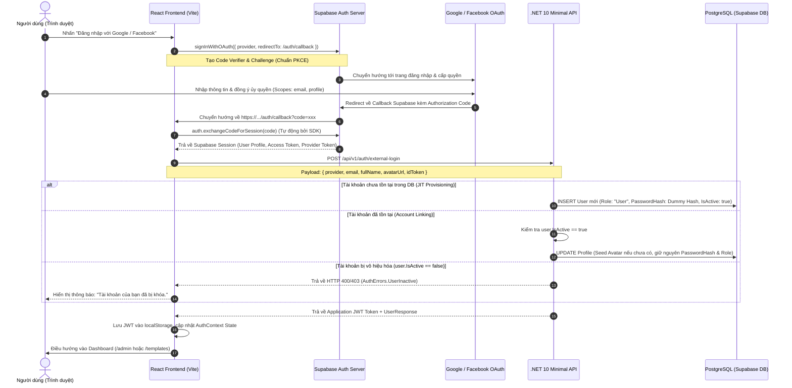

# TÀI LIỆU HƯỚNG DẪN CẤU HÌNH VÀ VẬN HÀNH XÁC THỰC OAUTH (GOOGLE & FACEBOOK)

> **Dự án**: Template Landing Page  
> **Kiến trúc**: Hybrid OAuth PKCE (React 18/19 Vite SPA + Supabase Auth SDK + .NET 10 Clean Architecture Backend + PostgreSQL)  
> **Ngày cập nhật**: 23/09/2026  
> **Trạng thái**: Hoàn thiện & Sẵn sàng Triển khai Sản xuất (Production-Ready)

---

## MỤC LỤC

1. [Phần 1: Tổng Quan Kiến Trúc PKCE Hybrid & Luồng Dữ Liệu](#phần-1-tổng-quan-kiến-trúc-pkce-hybrid--luồng-dữ-liệu)
2. [Phần 2: Hướng Dẫn Cấu Hình Google Cloud Console](#phần-2-hướng-dẫn-cấu-hình-google-cloud-console)
3. [Phần 3: Hướng Dẫn Cấu Hình Meta for Developers (Facebook Login)](#phần-3-hướng-dẫn-cấu-hình-meta-for-developers-facebook-login)
4. [Phần 4: Hướng Dẫn Cấu Hình Supabase Console](#phần-4-hướng-dẫn-cấu-hình-supabase-console)
5. [Phần 5: Hướng Dẫn Cấu Hình Môi Trường Local Development](#phần-5-hướng-dẫn-cấu-hình-môi-trường-local-development)
6. [Phần 6: Hướng Dẫn Cấu Hình Môi Trường Production (Render & Vercel)](#phần-6-hướng-dẫn-cấu-hình-môi-trường-production-render--vercel)
7. [Phần 7: Bảng Xử Lý Sự Cố Thường Gặp (Troubleshooting Guide)](#phần-7-bảng-xử-lý-sự-cố-thường-gặp-troubleshooting-guide)

---

## PHẦN 1: TỔNG QUAN KIẾN TRÚC PKCE HYBRID & LUỒNG DỮ LIỆU

### 1.1. Bối Cảnh Kiến Trúc
Hệ thống **Template Landing Page** áp dụng mô hình xác thực **Hybrid PKCE (Proof Key for Code Exchange)** kết hợp giữa **Supabase Auth** ở tầng Client và **.NET 10 Web API** ở tầng Backend:
- **Tầng Client (React SPA)**: Sử dụng `@supabase/supabase-js` để thực hiện Authorization Code Flow with PKCE. Quá trình trao đổi Authorization Code lấy Token diễn ra an toàn trực tiếp giữa trình duyệt và Supabase Auth Server mà **không lưu trữ bất kỳ Client Secret nhạy cảm nào** ở phía client.
- **Tầng Backend (.NET 10)**: Sau khi Supabase cấp Session thành công ở frontend, React gửi payload định danh (Email, FullName, AvatarUrl, Provider, IdToken) về endpoint Minimal API `POST /api/v1/auth/external-login`. Backend kiểm tra trạng thái tài khoản, thực hiện **JIT Provisioning (Just-In-Time Provisioning)** hoặc **Account Linking**, sau đó phát hành **JWT Token độc lập của hệ thống** (HMAC-SHA256) với đầy đủ Claims phân quyền (`Admin` hoặc `User`).

### 1.2. Sơ Đồ Trình Tự Xác Thực (Sequence Diagram)



### 1.3. Các Nguyên Tắc Thiết Kế Nghiệp Vụ Cốt Lõi
1. **Bảo mật Secret Key**: Google Client Secret và Facebook App Secret **chỉ lưu tại Supabase Console**. Không xuất hiện ở React code, không xuất hiện ở file git tracking.
2. **Account Linking theo Email Chuẩn Hóa**: Email luôn được normalize (`.Trim().ToLowerInvariant()`). Nếu người dùng từng đăng ký bằng Email/Password, việc đăng nhập lại bằng Google/Facebook có cùng email sẽ liên kết an toàn vào tài khoản đó, **không làm mất mật khẩu cũ**.
3. **Phân quyền bất biến (Role Invariance)**: Nếu một tài khoản quản trị viên (`Role = "Admin"`) đăng nhập bằng Google/Facebook, hệ thống bảo tồn quyền `Admin`, tuyệt đối không bị reset về `User`.
4. **Avatar Seeding thông minh**: Nếu tài khoản đã có avatar tùy chỉnh trước đó, hệ thống không ghi đè; chỉ điền avatar lấy từ Google/Facebook khi trường `AvatarUrl` trong cơ sở dữ liệu đang rỗng.
5. **Dummy Password không thể tấn công**: Với tài khoản tạo mới qua OAuth, mật khẩu hash được sinh ngẫu nhiên theo khuôn dạng `EXTERNAL_{PROVIDER}_{GUID}` với chi phí hash cao, triệt tiêu nguy cơ đăng nhập qua form mật khẩu thông thường.

---

## PHẦN 2: HƯỚNG DẪN CẤU HÌNH GOOGLE CLOUD CONSOLE

### Bước 2.1: Tạo Project mới trên Google Cloud
1. Truy cập [Google Cloud Console](https://console.cloud.google.com/).
2. Đăng nhập tài khoản Google quản trị.
3. Ở thanh điều hướng trên cùng, nhấn vào menu chọn Project -> chọn **New Project** (Dự án mới).
4. Đặt tên dự án (ví dụ: `Template-Landing-Page`) -> Nhấn **Create**.

### Bước 2.2: Cấu hình Màn hình đồng thuận OAuth (OAuth Consent Screen)
1. Trong menu bên trái, truy cập: **APIs & Services** -> **OAuth consent screen**.
2. Chọn **User Type**:
   - Chọn **External** (Bên ngoài) để mọi tài khoản Google cá nhân (@gmail.com) đều có thể đăng nhập được.
   - Nhấn **Create**.
3. Điền thông tin ứng dụng (**App information**):
   - **App name**: `Template Landing Page`
   - **User support email**: Chọn email quản trị của bạn.
   - **App logo**: Tải lên logo dự án (tùy chọn).
   - **Application home page**: `https://template-landing-page-pied.vercel.app` (hoặc domain production của bạn).
   - **Developer contact information**: Điền email của bạn.
   - Nhấn **Save and Continue**.
4. Cấu hình Scopes (**Scopes**):
   - Nhấn **Add or Remove Scopes**.
   - Tích chọn 3 scopes cơ bản:
     - `.../auth/userinfo.email`
     - `.../auth/userinfo.profile`
     - `openid`
   - Nhấn **Update** -> **Save and Continue**.
5. Môi trường kiểm thử (**Test Users**):
   - Nếu dự án đang ở trạng thái **Testing**, bạn cần nhấn **Add Users** và điền các email Google được phép thử nghiệm.
   - Khi sẵn sàng public, nhấn **Publish App** để chuyển sang trạng thái **In production** (cho phép bất kỳ ai đăng nhập).

### Bước 2.3: Tạo OAuth 2.0 Client ID (Web Application)
1. Trong menu bên trái, truy cập: **APIs & Services** -> **Credentials**.
2. Nhấn **+ Create Credentials** ở trên cùng -> Chọn **OAuth client ID**.
3. Cấu hình thông tin:
   - **Application type**: Chọn **Web application**.
   - **Name**: `Template Landing Page Web Client`.
4. Cấu hình **Authorized JavaScript origins** (Nguồn gốc JavaScript được phép):
   - `http://localhost:5173`
   - `https://womdjbjgsnokbntdidoc.supabase.co` *(thay bằng Supabase URL của bạn)*
   - `https://template-landing-page-pied.vercel.app` *(thay bằng domain frontend của bạn)*
5. Cấu hình **Authorized redirect URIs** (URI chuyển hướng được phép):
   - Điền chính xác Callback URL của Supabase Auth:
     ```
     https://womdjbjgsnokbntdidoc.supabase.co/auth/v1/callback
     ```
   > ⚠️ **LƯU Ý CỰC KỲ QUAN TRỌNG**: Redirect URI ở Google Cloud Console **phải trỏ về Supabase Auth Callback**, TUYỆT ĐỐI KHÔNG trỏ thẳng về `http://localhost:5173/auth/callback` vì Supabase là đơn vị trung gian trao đổi code.
6. Nhấn **Create**.
7. Cửa sổ bật lên chứa thông tin đăng nhập:
   - **Client ID** (dạng `xxxxxxxxxxxx-xxxxxxxxxxxxxxxx.apps.googleusercontent.com`)
   - **Client Secret** (dạng `GOCSPX-xxxxxxxxxxxxxxxxxxxxxxxx`)
   - Hãy sao chép 2 giá trị này lại để cấu hình vào Supabase ở Phần 4.

---

## PHẦN 3: HƯỚNG DẪN CẤU HÌNH META FOR DEVELOPERS (FACEBOOK LOGIN)

### Bước 3.1: Đăng ký tài khoản Meta Developer & Tạo App
1. Truy cập [Meta for Developers](https://developers.facebook.com/).
2. Đăng nhập và nhấn **My Apps** (Ứng dụng của tôi) -> Nhấn **Create App** (Tạo ứng dụng).
3. Chọn mục tiêu sử dụng ứng dụng:
   - Chọn **Authenticate and request data from users with Facebook Login** (Xác thực và yêu cầu dữ liệu từ người dùng bằng Facebook Login) hoặc chọn loại **Consumer** (Người tiêu dùng).
   - Nhấn **Next**.
4. Điền chi tiết ứng dụng:
   - **App Name**: `Template Landing Page`
   - **App Contact Email**: Email quản trị viên của bạn.
   - Nhấn **Create App**.

### Bước 3.2: Thêm sản phẩm Facebook Login
1. Tại trang **Dashboard** của ứng dụng, tìm ô **Facebook Login** (hoặc Facebook Login for Business) -> Nhấn **Set Up** (Thiết lập).
2. Chọn nền tảng: **Web**.
3. Điền **Site URL**: `https://template-landing-page-pied.vercel.app` (hoặc `http://localhost:5173` khi test).
4. Nhấn **Save**.

### Bước 3.3: Cấu hình Cài đặt Facebook Login (OAuth Settings)
1. Ở menu bên trái, mở rộng mục **Facebook Login** -> Chọn **Settings** (Cài đặt).
2. Kiểm tra các công tắc:
   - **Client OAuth Login**: `Yes`
   - **Web OAuth Login**: `Yes`
   - **Enforce HTTPS**: `Yes`
3. Tại ô **Valid OAuth Redirect URIs** (URI chuyển hướng OAuth hợp lệ):
   - Điền chính xác Callback URL của Supabase Auth:
     ```
     https://womdjbjgsnokbntdidoc.supabase.co/auth/v1/callback
     ```
4. Nhấn **Save Changes** (Lưu thay đổi) ở góc dưới cùng.

### Bước 3.4: Bật chế độ Live (Chính thức)
1. Ở menu bên trái, chọn **App settings** -> **Basic** (Cơ bản).
2. Điền các trường bắt buộc để chuyển ứng dụng sang Live:
   - **Privacy Policy URL**: `https://template-landing-page-pied.vercel.app/privacy` (hoặc đường dẫn chính sách bảo mật hợp lệ).
   - **User Data Deletion**: Chọn URL hướng dẫn xóa dữ liệu (ví dụ: `https://template-landing-page-pied.vercel.app/data-deletion`).
   - **Category**: Chọn danh mục phù hợp (ví dụ: *Business and Pages* hoặc *Utilities*).
3. Nhấn **Save changes**.
4. Tại góc trên cùng của thanh tiêu đề, chuyển công tắc **App Mode: Development** sang **App Mode: Live**.
5. Sao chép lại 2 thông số:
   - **App ID** (Dãy số công khai)
   - **App Secret** (Bấm *Show* và nhập mật khẩu để lấy mã bí mật)

---

## PHẦN 4: HƯỚNG DẪN CẤU HÌNH SUPABASE CONSOLE

### Bước 4.1: Bật Google Provider trên Supabase
1. Truy cập [Supabase Dashboard](https://supabase.com/dashboard) và chọn Project của bạn (ví dụ: `womdjbjgsnokbntdidoc`).
2. Vào menu bên trái: **Authentication** -> **Providers**.
3. Tìm **Google** trong danh sách và nhấn vào để mở cài đặt:
   - Chuyển công tắc **Enable Sign in with Google** sang **ON**.
   - **Client ID**: Dán Client ID đã lấy từ Google Cloud Console (Phần 2.3).
   - **Client Secret**: Dán Client Secret đã lấy từ Google Cloud Console (Phần 2.3).
   - Tùy chọn **Skip nonce checks**: Để mặc định (hoặc bật nếu có xung đột nonce trong một số thư viện client).
4. Nhấn **Save**.

### Bước 4.2: Bật Facebook Provider trên Supabase
1. Tại trang **Authentication** -> **Providers**, tìm **Facebook**.
2. Nhấn vào để mở cài đặt:
   - Chuyển công tắc **Enable Sign in with Facebook** sang **ON**.
   - **Client ID (App ID)**: Dán App ID đã lấy từ Meta for Developers (Phần 3.4).
   - **Client Secret (App Secret)**: Dán App Secret đã lấy từ Meta for Developers (Phần 3.4).
3. Nhấn **Save**.

### Bước 4.3: Cấu hình URL Configuration & Whitelist Redirects
1. Trong menu bên trái, truy cập: **Authentication** -> **URL Configuration**.
2. Cấu hình **Site URL**:
   - Khi ở Production: Điền domain frontend chính thức (ví dụ: `https://template-landing-page-pied.vercel.app`).
   - Khi chạy Local: Có thể đặt là `http://localhost:5173`.
3. Cấu hình **Redirect URLs** (Danh sách URL được phép chuyển hướng sau xác thực):
   Nhấn **Add URL** và thêm đầy đủ các đường dẫn sau (hỗ trợ cả Localhost, Production và Vercel Preview):
   - `http://localhost:5173/**`
   - `http://localhost:5173/auth/callback`
   - `https://template-landing-page-pied.vercel.app/**`
   - `https://template-landing-page-pied.vercel.app/auth/callback`
   - `https://*.vercel.app/**`
   - `https://*.vercel.app/auth/callback`
4. Nhấn **Save**.

### Bước 4.4: Lấy Project URL, Anon Key & Chuỗi Kết Nối PostgreSQL
1. Truy cập **Project Settings** (biểu tượng bánh răng) -> **API**:
   - **Project URL**: Ví dụ `https://womdjbjgsnokbntdidoc.supabase.co` -> Dùng cho `VITE_SUPABASE_URL`.
   - **Project API Keys**:
     - Copy khóa `anon` / `public` (hoặc Publishable Key mới có dạng `sb_publishable_...`) -> Dùng cho `VITE_SUPABASE_ANON_KEY`.
2. Truy cập **Project Settings** -> **Database**:
   - Cuộn xuống phần **Connection string**:
   - Chọn tab **URI** hoặc **Parameters** (chế độ **Session pooler** cổng 5432 hoặc **Transaction pooler** cổng 6543):
   - Ví dụ chuỗi kết nối dùng cho .NET:
     ```
     Host=aws-0-ap-southeast-1.pooler.supabase.com;Port=5432;Database=postgres;Username=postgres.womdjbjgsnokbntdidoc;Password=[YOUR-PASSWORD];SSL Mode=Require;Trust Server Certificate=true;
     ```

---

## PHẦN 5: HƯỚNG DẪN CẤU HÌNH MÔI TRƯỜNG LOCAL DEVELOPMENT

### 5.1. Cấu hình Backend (.NET 10)
Tạo hoặc kiểm tra file cấu hình `BE/src/API/appsettings.Development.json` (được cách ly bởi `.gitignore`, không commit lên git):

```json
{
  "Logging": {
    "LogLevel": {
      "Default": "Information",
      "Microsoft.AspNetCore": "Warning",
      "Microsoft.EntityFrameworkCore.Database.Command": "Information"
    }
  },
  "AllowedHosts": "*",
  "ConnectionStrings": {
    "DefaultConnection": "Host=aws-0-ap-southeast-1.pooler.supabase.com;Port=5432;Database=postgres;Username=postgres.womdjbjgsnokbntdidoc;Password=YOUR_ACTUAL_DB_PASSWORD;SSL Mode=Require;Trust Server Certificate=true;"
  },
  "Cors": {
    "AllowedOrigins": [
      "http://localhost:5173",
      "http://localhost:3000"
    ]
  },
  "Jwt": {
    "Issuer": "TemplateLandingPage",
    "Audience": "TemplateLandingPage",
    "SecretKey": "SuperSecretKeyForTemplateLandingPage2026!@#$%^&*",
    "ExpirationMinutes": 1440
  }
}
```

### 5.2. Cấu hình Frontend (React / Vite)
Tạo hoặc kiểm tra file `FE/.env` (được bảo vệ bởi `.gitignore`):

```bash
# Backend API Base URL
VITE_API_BASE_URL=http://localhost:5000/api/v1

# Supabase Auth Configuration
VITE_SUPABASE_URL=https://womdjbjgsnokbntdidoc.supabase.co

# Hỗ trợ cả 2 chuẩn biến môi trường của Supabase:
VITE_SUPABASE_ANON_KEY=sb_publishable_0FGvfyZ3B8mTBvAoBFYclw_28thdQiM
# Hoặc:
VITE_SUPABASE_PUBLISHABLE_KEY=sb_publishable_0FGvfyZ3B8mTBvAoBFYclw_28thdQiM
```

### 5.3. Các Lệnh Khởi Chạy Local Song Song
Mở 2 cửa sổ terminal riêng biệt để chạy Backend và Frontend:

**Cửa sổ 1: Backend (.NET 10)**
```powershell
# Chạy migration (nếu cần cập nhật schema DB)
dotnet ef database update --project BE/src/Persistence --startup-project BE/src/API

# Khởi chạy Web API trên cổng http://localhost:5000
dotnet run --project BE/src/API --urls="http://localhost:5000"
```

**Cửa sổ 2: Frontend (React Vite)**
```powershell
cd FE
npm install
npm run dev
```

Mở trình duyệt truy cập: `http://localhost:5173/login`.  
Nhấn **Tiếp tục với Google** hoặc **Tiếp tục với Facebook** để thử nghiệm luồng OAuth hoàn chỉnh.

---

## PHẦN 6: HƯỚNG DẪN CẤU HÌNH MÔI TRƯỜNG PRODUCTION (RENDER & VERCEL)

### 6.1. Triển Khai Backend Lên Render (Web Service)
1. Đăng nhập [Render Dashboard](https://dashboard.render.com/).
2. Nhấn **New +** -> Chọn **Web Service**.
3. Kết nối với GitHub Repository của dự án.
4. Cấu hình cơ bản:
   - **Name**: `templatelandingpage` (hoặc tên theo nhu cầu của bạn)
   - **Language**: `Docker` (sử dụng `Dockerfile` ở root của repo) hoặc `Native .NET`
   - **Region**: `Singapore (Southeast Asia)` (cùng khu vực `ap-southeast-1` với Supabase để giảm độ trễ truy vấn DB).
   - **Branch**: `main`
5. Thiết lập **Environment Variables** trong mục **Environment**:

| Tên biến môi trường (Key) | Giá trị mẫu (Value) | Ghi chú |
|---|---|---|
| `ASPNETCORE_ENVIRONMENT` | `Production` | Chế độ chạy Production |
| `ConnectionStrings__DefaultConnection` | `Host=aws-0-ap-southeast-1.pooler.supabase.com;Port=5432;Database=postgres;Username=postgres.womdjbjgsnokbntdidoc;Password=YOUR_PROD_DB_PASSWORD;SSL Mode=Require;Trust Server Certificate=true;` | Chuỗi kết nối Postgres Supabase |
| `Jwt__Issuer` | `TemplateLandingPage` | Khớp với quy ước ứng dụng |
| `Jwt__Audience` | `TemplateLandingPage` | Khớp với quy ước ứng dụng |
| `Jwt__SecretKey` | `PROD_SUPER_SECURE_KEY_AT_LEAST_32_CHARACTERS_LONG_2026_XYZ` | Khóa ký bí mật production ngẫu nhiên |
| `Jwt__ExpirationMinutes` | `1440` | Thời hạn JWT (24 giờ) |
| `Cors__AllowedOrigins__0` | `https://template-landing-page-pied.vercel.app` | Domain Frontend chính thức trên Vercel |
| `Cors__AllowedOrigins__1` | `https://*.vercel.app` | Cho phép các nhánh xem trước của Vercel |
| `Cors__AllowedOrigins__2` | `http://localhost:5173` | Hỗ trợ lập trình viên kiểm thử |

6. Nhấn **Deploy Web Service**.  
   Địa chỉ API Production sẽ có dạng: `https://templatelandingpage.onrender.com`.

---

### 6.2. Triển Khai Frontend Lên Vercel
1. Đăng nhập [Vercel Dashboard](https://vercel.com/).
2. Nhấn **Add New...** -> Chọn **Project**.
3. Import Repository dự án từ GitHub.
4. Cấu hình Framework Preset & Thư mục nguồn:
   - **Framework Preset**: `Vite`
   - **Root Directory**: Nhấn Edit và chọn `FE`
   - **Build Command**: `npm run build`
   - **Output Directory**: `dist`
5. Cấu hình **Environment Variables** (áp dụng cho cả Production, Preview, Development):

| Tên biến môi trường (Key) | Giá trị (Value) |
|---|---|
| `VITE_API_BASE_URL` | `https://templatelandingpage.onrender.com/api/v1` |
| `VITE_SUPABASE_URL` | `https://womdjbjgsnokbntdidoc.supabase.co` |
| `VITE_SUPABASE_ANON_KEY` | `sb_publishable_0FGvfyZ3B8mTBvAoBFYclw_28thdQiM` |
| `VITE_SUPABASE_PUBLISHABLE_KEY` | `sb_publishable_0FGvfyZ3B8mTBvAoBFYclw_28thdQiM` |

6. Nhấn **Deploy**.

---

### 6.3. Bảng Kiểm Tra Đồng Bộ CORS & Redirect Whitelist
Trước khi nghiệm thu Go-Live, hãy kiểm tra chéo bảng ma trận chuyển hướng sau:

| Chiều liên kết | Thành phần kiểm tra | Giá trị bắt buộc phải có |
|---|---|---|
| **Google Cloud Console** | Authorized JavaScript origins | Domain Vercel (`https://template-landing-page-pied.vercel.app`) & Supabase URL |
| **Google Cloud Console** | Authorized redirect URIs | `https://womdjbjgsnokbntdidoc.supabase.co/auth/v1/callback` |
| **Meta Developers** | Valid OAuth Redirect URIs | `https://womdjbjgsnokbntdidoc.supabase.co/auth/v1/callback` |
| **Supabase Console** | Redirect URLs | `https://template-landing-page-pied.vercel.app/**`, `https://*.vercel.app/**`, `http://localhost:5173/**` |
| **Render Backend** | `Cors__AllowedOrigins` | Domain Vercel chính xác không thừa dấu gạch chéo cuối (`/`) |

---

## PHẦN 7: BẢNG XỬ LÝ SỰ CỐ THƯỜNG GẶP (TROUBLESHOOTING GUIDE)

### Bảng Tổng Hợp Lỗi & Giải Pháp Khắc Phục

| Mã / Hiện tượng lỗi | Nguyên nhân gốc rễ | Cách xử lý dứt điểm |
|---|---|---|
| **`redirect_uri_mismatch`** (Google Error 400) | Callback URL được cấu hình tại Google Cloud Console không khớp với URL Supabase gửi lên. | 1. Vào Google Cloud Console -> APIs & Services -> Credentials -> OAuth 2.0 Client.<br>2. Kiểm tra ô **Authorized redirect URIs**.<br>3. Đảm bảo có chính xác: `https://<YOUR-PROJECT-REF>.supabase.co/auth/v1/callback` (không có dấu cách thừa hoặc ký tự `/` ở cuối). |
| **URL Blocked / Redirect Failed** (Facebook OAuth) | Callback URL chưa được thêm vào whitelist của Facebook Login. | 1. Vào Meta for Developers -> App -> Facebook Login -> Settings.<br>2. Nhập URL `https://<YOUR-PROJECT-REF>.supabase.co/auth/v1/callback` vào ô **Valid OAuth Redirect URIs**.<br>3. Bấm **Save Changes**. |
| **App Not Active** (Facebook Error) | Ứng dụng Facebook vẫn đang ở chế độ **Development**, chỉ tài khoản admin/developer của app mới đăng nhập được. | 1. Vào Meta Developers -> App settings -> Basic.<br>2. Điền đầy đủ Privacy Policy URL.<br>3. Chuyển công tắc chế độ từ **In development** sang **Live**.<br>4. Trong **App Review -> Permissions and Features**, đảm bảo `email` và `public_profile` đã có quyền truy cập nâng cao (Advanced Access). |
| **`Invalid API Key` hoặc 401 Unauthorized từ Supabase** | Biến môi trường `VITE_SUPABASE_ANON_KEY` bị thiếu, trống hoặc sai key. | 1. Kiểm tra file `FE/.env` (Local) hoặc Settings Environment Variables trên Vercel.<br>2. Đảm bảo biến `VITE_SUPABASE_ANON_KEY` hoặc `VITE_SUPABASE_PUBLISHABLE_KEY` chứa chuỗi khóa public hợp lệ lấy từ Supabase Project Settings -> API. |
| **CORS Policy Error** (`Access-Control-Allow-Origin`) | Backend .NET chặn yêu cầu `POST /api/v1/auth/external-login` từ trình duyệt vì domain frontend chưa có trong danh sách CORS. | 1. Trên Render, vào Environment Variables của Web Service.<br>2. Kiểm tra `Cors__AllowedOrigins__0`: phải điền đúng `https://template-landing-page-pied.vercel.app` (Lưu ý: Không để dấu `/` ở cuối domain).<br>3. Redeploy service để cấu hình có hiệu lực. |
| **Lỗi `Auth.UserInactive` ("Tài khoản của bạn đã bị khóa")** | Trường `IsActive` của bản ghi User trong bảng `Users` đang có giá trị `false`. | 1. Mở Supabase SQL Editor.<br>2. Chạy lệnh kích hoạt lại: `UPDATE "Users" SET "IsActive" = true WHERE "Email" = 'user@example.com';`. |
| **Xác thực treo ở `/auth/callback` rồi timeout sau 7 giây** | Trình duyệt bị lỗi mạng, chặn pop-up / bên thứ 3 hoặc session exchange không kích hoạt event `SIGNED_IN`. | 1. Màn hình `AuthCallbackPage.jsx` đã có cơ chế tự động timeout sau 7 giây và nút "Thử đăng nhập lại" thân thiện.<br>2. Hướng dẫn người dùng tắt các tiện ích chặn script (Adblock/Brave Shields) hoặc mở tab ẩn danh. |

---

### Cách Kiểm Tra Logs Để Định Tuyến Sự Cố
1. **Kiểm tra Log xác thực trên Supabase**:
   - Truy cập Supabase Dashboard -> **Logs** -> **Auth Logs**.
   - Tìm các sự kiện có HTTP status `400`, `401`, hoặc `error_code` để xem chi tiết thông báo lỗi từ nhà cung cấp danh tính (Google/Facebook).
2. **Kiểm tra Log Backend API trên Render**:
   - Truy cập Render Dashboard -> Chọn Service `templatelandingpage` -> Chọn tab **Logs**.
   - Xem log xử lý request `POST /api/v1/auth/external-login`. Các lỗi EF Core hoặc Database Connection sẽ được ghi nhận rõ ràng tại đây.
3. **Kiểm tra Log Trình duyệt (Console & Network)**:
   - Nhấn `F12` trên trình duyệt -> Mở tab **Console** và **Network**.
   - Kiểm tra request gửi tới `/auth/external-login`: xem Request Payload và Response body trả về từ Backend để biết mã lỗi chi tiết.
