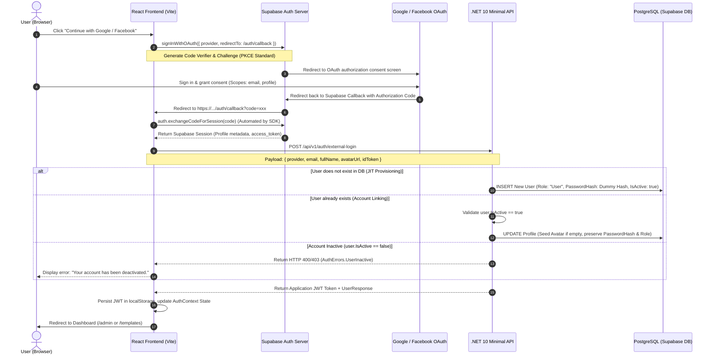

# OAUTH 2.0 (GOOGLE & FACEBOOK) CONFIGURATION & DEPLOYMENT GUIDE

> **Project**: Template Landing Page  
> **Architecture**: Hybrid PKCE OAuth (React 18/19 Vite SPA + Supabase Auth SDK + .NET 10 Clean Architecture Backend + PostgreSQL)  
> **Last Updated**: September 23, 2026  
> **Status**: Production-Ready

---

## TABLE OF CONTENTS

1. [Part 1: Hybrid PKCE Architecture & Data Flow Overview](#part-1-hybrid-pkce-architecture--data-flow-overview)
2. [Part 2: Google Cloud Console Configuration Guide](#part-2-google-cloud-console-configuration-guide)
3. [Part 3: Meta for Developers (Facebook Login) Configuration Guide](#part-3-meta-for-developers-facebook-login-configuration-guide)
4. [Part 4: Supabase Console Configuration Guide](#part-4-supabase-console-configuration-guide)
5. [Part 5: Local Development Environment Setup](#part-5-local-development-environment-setup)
6. [Part 6: Production Deployment Configuration (Render & Vercel)](#part-6-production-deployment-configuration-render--vercel)
7. [Part 7: Troubleshooting & Common Pitfalls Guide](#part-7-troubleshooting--common-pitfalls-guide)

---

## PART 1: HYBRID PKCE ARCHITECTURE & DATA FLOW OVERVIEW

### 1.1. Architectural Philosophy
The **Template Landing Page** application leverages a **Hybrid PKCE (Proof Key for Code Exchange)** authentication design, unifying modern SPA client authentication with an enterprise-grade .NET 10 Backend API:
- **Client Layer (React Vite SPA)**: Interacts with `@supabase/supabase-js` to perform the Authorization Code Flow with PKCE. This ensures authorization codes are exchanged directly between the user's browser and the Supabase Auth Server. **No client secrets are ever stored, exposed, or transmitted via client code**.
- **Backend Layer (.NET 10 Web API)**: Upon receiving a successful Supabase session in the frontend, the client dispatches the user credentials payload (`provider`, `email`, `fullName`, `avatarUrl`, `idToken`) to the Minimal API endpoint `POST /api/v1/auth/external-login`. The backend executes **JIT Provisioning (Just-In-Time)** or **Account Linking**, verifies account activation status, and issues an **independent application JWT token** (HMAC-SHA256) loaded with domain claims (`Admin` or `User`).

### 1.2. Authentication Sequence Diagram



### 1.3. Core Domain Security Invariants
1. **Secret Key Isolation**: Google Client Secret and Facebook App Secret reside exclusively in the **Supabase Dashboard**. Neither git repos nor client bundles have access to these secrets.
2. **Normalized Account Linking**: User emails are normalized (`.Trim().ToLowerInvariant()`). If a user initially registered via traditional email/password, logging in with Google/Facebook will securely link without deleting or overwriting the pre-existing `PasswordHash`.
3. **Role Invariance**: If an existing account has `Role = "Admin"`, authenticating via OAuth will strictly preserve administrator privileges and never demote the user to `"User"`.
4. **Non-destructive Avatar Seeding**: The user's avatar is only populated from OAuth provider metadata if `AvatarUrl` is currently null or empty. Custom uploaded avatars are never overwritten.
5. **Brute-force Resistant Dummy Passwords**: For JIT-created OAuth accounts, password hashes are generated with high complexity (`EXTERNAL_{PROVIDER}_{GUID}`) so that direct password-based brute force is impossible.

---

## PART 2: GOOGLE CLOUD CONSOLE CONFIGURATION GUIDE

### Step 2.1: Create a Google Cloud Project
1. Navigate to the [Google Cloud Console](https://console.cloud.google.com/).
2. Sign in with your administrative Google account.
3. In the top navigation bar, click the project dropdown and select **New Project**.
4. Enter the project name (e.g., `Template-Landing-Page`) and click **Create**.

### Step 2.2: Configure OAuth Consent Screen
1. In the left navigation sidebar, navigate to **APIs & Services** -> **OAuth consent screen**.
2. Select **User Type**:
   - Choose **External** so any public Google account (@gmail.com or Workspace) can log in.
   - Click **Create**.
3. Fill in **App information**:
   - **App name**: `Template Landing Page`
   - **User support email**: Select your developer/admin email.
   - **App logo**: Optional.
   - **Application home page**: `https://template-landing-page-pied.vercel.app` (or your domain).
   - **Developer contact information**: Enter your contact email.
   - Click **Save and Continue**.
4. Configure **Scopes**:
   - Click **Add or Remove Scopes**.
   - Select the following standard OpenID scopes:
     - `.../auth/userinfo.email`
     - `.../auth/userinfo.profile`
     - `openid`
   - Click **Update** -> **Save and Continue**.
5. Testing / Production Status:
   - For internal testing, add target emails under **Test Users**.
   - For public access, click **Publish App** to switch the app to **In production**.

### Step 2.3: Generate OAuth 2.0 Client Credentials
1. In the left sidebar, navigate to **APIs & Services** -> **Credentials**.
2. Click **+ Create Credentials** at the top -> Choose **OAuth client ID**.
3. Configure settings:
   - **Application type**: Select **Web application**.
   - **Name**: `Template Landing Page Web Client`.
4. Configure **Authorized JavaScript origins**:
   - `http://localhost:5173`
   - `https://womdjbjgsnokbntdidoc.supabase.co` *(replace with your Supabase URL)*
   - `https://template-landing-page-pied.vercel.app` *(replace with your production domain)*
5. Configure **Authorized redirect URIs**:
   - Enter your exact Supabase Auth Callback URL:
     ```
     https://womdjbjgsnokbntdidoc.supabase.co/auth/v1/callback
     ```
   > ⚠️ **CRITICAL WARNING**: The redirect URI in Google Cloud Console must point to your **Supabase Callback URL**, NOT directly to `localhost:5173/auth/callback`. Supabase acts as the intermediary OAuth token broker.
6. Click **Create**.
7. Note down the generated credentials:
   - **Client ID** (format: `xxxxxxxxxxxx-xxxxxxxxxxxxxxxx.apps.googleusercontent.com`)
   - **Client Secret** (format: `GOCSPX-xxxxxxxxxxxxxxxxxxxxxxxx`)

---

## PART 3: META FOR DEVELOPERS (FACEBOOK LOGIN) CONFIGURATION GUIDE

### Step 3.1: Register as a Meta Developer & Create App
1. Go to [Meta for Developers](https://developers.facebook.com/).
2. Log in and navigate to **My Apps** -> Click **Create App**.
3. Select an App use case:
   - Choose **Authenticate and request data from users with Facebook Login** (or **Consumer**).
   - Click **Next**.
4. Enter app details:
   - **App Name**: `Template Landing Page`
   - **App Contact Email**: Your admin email.
   - Click **Create App**.

### Step 3.2: Set Up Facebook Login Product
1. On the app dashboard, find **Facebook Login** -> Click **Set Up**.
2. Choose platform: **Web**.
3. Enter **Site URL**: `https://template-landing-page-pied.vercel.app` (or `http://localhost:5173`).
4. Click **Save**.

### Step 3.3: Configure Facebook Login OAuth Settings
1. In the left menu, expand **Facebook Login** -> Select **Settings**.
2. Verify settings:
   - **Client OAuth Login**: `Yes`
   - **Web OAuth Login**: `Yes`
   - **Enforce HTTPS**: `Yes`
3. In **Valid OAuth Redirect URIs**:
   - Enter your exact Supabase Auth Callback URL:
     ```
     https://womdjbjgsnokbntdidoc.supabase.co/auth/v1/callback
     ```
4. Click **Save Changes**.

### Step 3.4: Switch App to Live Mode
1. In the left menu, navigate to **App settings** -> **Basic**.
2. Fill in the required compliance URLs:
   - **Privacy Policy URL**: `https://template-landing-page-pied.vercel.app/privacy`
   - **User Data Deletion**: Enter deletion instructions URL.
   - **Category**: E.g., *Business and Pages* or *Utilities*.
3. Click **Save changes**.
4. At the top navigation bar, toggle **App Mode** from **Development** to **Live**.
5. Under **App Review** -> **Permissions and Features**, ensure `email` and `public_profile` have **Advanced Access**.
6. Copy the credentials:
   - **App ID** (Numeric string)
   - **App Secret** (Click *Show* and enter your password)

---

## PART 4: SUPABASE CONSOLE CONFIGURATION GUIDE

### Step 4.1: Enable Google Provider in Supabase
1. Navigate to the [Supabase Dashboard](https://supabase.com/dashboard) and select your project (`womdjbjgsnokbntdidoc`).
2. Go to **Authentication** -> **Providers** in the left sidebar.
3. Locate **Google** and toggle **Enable Sign in with Google** to **ON**:
   - **Client ID**: Paste the Client ID from Google Cloud Console.
   - **Client Secret**: Paste the Client Secret from Google Cloud Console.
4. Click **Save**.

### Step 4.2: Enable Facebook Provider in Supabase
1. In **Authentication** -> **Providers**, locate **Facebook**.
2. Toggle **Enable Sign in with Facebook** to **ON**:
   - **Client ID (App ID)**: Paste the Facebook App ID.
   - **Client Secret (App Secret)**: Paste the Facebook App Secret.
3. Click **Save**.

### Step 4.3: Configure URL Configuration & Whitelist Redirects
1. Go to **Authentication** -> **URL Configuration**.
2. Configure **Site URL**:
   - Production: `https://template-landing-page-pied.vercel.app` (or `http://localhost:5173` in local testing).
3. Configure **Redirect URLs**:
   Click **Add URL** and register all valid redirect targets:
   - `http://localhost:5173/**`
   - `http://localhost:5173/auth/callback`
   - `https://template-landing-page-pied.vercel.app/**`
   - `https://template-landing-page-pied.vercel.app/auth/callback`
   - `https://*.vercel.app/**`
   - `https://*.vercel.app/auth/callback`
4. Click **Save**.

### Step 4.4: Retrieve API Keys & Database Connection String
1. Go to **Project Settings** (gear icon) -> **API**:
   - **Project URL**: `https://womdjbjgsnokbntdidoc.supabase.co` -> Maps to `VITE_SUPABASE_URL`.
   - **Project API Keys**: Copy `anon` / `public` key (or newer `sb_publishable_...`) -> Maps to `VITE_SUPABASE_ANON_KEY`.
2. Go to **Project Settings** -> **Database**:
   - Scroll to **Connection string**:
   - Select **URI** or **Parameters** (Session Pooler on port 5432 or Transaction Pooler on port 6543):
     ```
     Host=aws-0-ap-southeast-1.pooler.supabase.com;Port=5432;Database=postgres;Username=postgres.womdjbjgsnokbntdidoc;Password=[YOUR-PASSWORD];SSL Mode=Require;Trust Server Certificate=true;
     ```

---

## PART 5: LOCAL DEVELOPMENT ENVIRONMENT SETUP

### 5.1. Backend Configuration (.NET 10)
Create or verify `BE/src/API/appsettings.Development.json` (gitignored, kept private):

```json
{
  "Logging": {
    "LogLevel": {
      "Default": "Information",
      "Microsoft.AspNetCore": "Warning",
      "Microsoft.EntityFrameworkCore.Database.Command": "Information"
    }
  },
  "AllowedHosts": "*",
  "ConnectionStrings": {
    "DefaultConnection": "Host=aws-0-ap-southeast-1.pooler.supabase.com;Port=5432;Database=postgres;Username=postgres.womdjbjgsnokbntdidoc;Password=YOUR_ACTUAL_DB_PASSWORD;SSL Mode=Require;Trust Server Certificate=true;"
  },
  "Cors": {
    "AllowedOrigins": [
      "http://localhost:5173",
      "http://localhost:3000"
    ]
  },
  "Jwt": {
    "Issuer": "TemplateLandingPage",
    "Audience": "TemplateLandingPage",
    "SecretKey": "SuperSecretKeyForTemplateLandingPage2026!@#$%^&*",
    "ExpirationMinutes": 1440
  }
}
```

### 5.2. Frontend Configuration (React / Vite)
Create or verify `FE/.env` (gitignored):

```bash
# Backend Web API Base URL
VITE_API_BASE_URL=http://localhost:5000/api/v1

# Supabase Auth Configuration
VITE_SUPABASE_URL=https://womdjbjgsnokbntdidoc.supabase.co

# Supports both legacy anon key and new publishable key:
VITE_SUPABASE_ANON_KEY=sb_publishable_0FGvfyZ3B8mTBvAoBFYclw_28thdQiM
# Or:
VITE_SUPABASE_PUBLISHABLE_KEY=sb_publishable_0FGvfyZ3B8mTBvAoBFYclw_28thdQiM
```

### 5.3. Running Local Servers
Open two terminal windows:

**Terminal 1: Backend (.NET 10)**
```powershell
# Run database migrations if necessary
dotnet ef database update --project BE/src/Persistence --startup-project BE/src/API

# Launch Web API on http://localhost:5000
dotnet run --project BE/src/API --urls="http://localhost:5000"
```

**Terminal 2: Frontend (React Vite)**
```powershell
cd FE
npm install
npm run dev
```

Open your browser at `http://localhost:5173/login`. Click **Continue with Google** or **Continue with Facebook** to test the complete OAuth lifecycle.

---

## PART 6: PRODUCTION DEPLOYMENT CONFIGURATION (RENDER & VERCEL)

### 6.1. Deploying Backend on Render (Web Service)
1. Sign in to the [Render Dashboard](https://dashboard.render.com/).
2. Click **New +** -> Select **Web Service**.
3. Connect your GitHub Repository.
4. Settings:
   - **Name**: `templatelandingpage`
   - **Language**: `Docker` (using repository root `Dockerfile`) or `Native .NET`
   - **Region**: `Singapore (Southeast Asia)` (same region as Supabase `ap-southeast-1` to minimize DB latency).
   - **Branch**: `main`
5. Configure **Environment Variables**:

| Variable Name | Recommended Value | Notes |
|---|---|---|
| `ASPNETCORE_ENVIRONMENT` | `Production` | Enables production security & settings |
| `ConnectionStrings__DefaultConnection` | `Host=aws-0-ap-southeast-1.pooler.supabase.com;Port=5432;Database=postgres;Username=postgres.womdjbjgsnokbntdidoc;Password=YOUR_PROD_PASSWORD;SSL Mode=Require;Trust Server Certificate=true;` | PostgreSQL connection pooler string |
| `Jwt__Issuer` | `TemplateLandingPage` | Matches token validation rules |
| `Jwt__Audience` | `TemplateLandingPage` | Matches token validation rules |
| `Jwt__SecretKey` | `PROD_SUPER_SECURE_KEY_AT_LEAST_32_CHARACTERS_LONG_2026_XYZ` | Cryptographically random secret |
| `Jwt__ExpirationMinutes` | `1440` | Token expiration (24 hours) |
| `Cors__AllowedOrigins__0` | `https://template-landing-page-pied.vercel.app` | Production frontend domain |
| `Cors__AllowedOrigins__1` | `https://*.vercel.app` | Allows preview deployment branches |
| `Cors__AllowedOrigins__2` | `http://localhost:5173` | Allows local development testing |

6. Click **Deploy Web Service**.

---

### 6.2. Deploying Frontend on Vercel
1. Sign in to the [Vercel Dashboard](https://vercel.com/).
2. Click **Add New...** -> Select **Project**.
3. Import your Git repository.
4. Configure build settings:
   - **Framework Preset**: `Vite`
   - **Root Directory**: `FE`
   - **Build Command**: `npm run build`
   - **Output Directory**: `dist`
5. Configure **Environment Variables** (for Production, Preview, and Development):

| Key | Value |
|---|---|
| `VITE_API_BASE_URL` | `https://templatelandingpage.onrender.com/api/v1` |
| `VITE_SUPABASE_URL` | `https://womdjbjgsnokbntdidoc.supabase.co` |
| `VITE_SUPABASE_ANON_KEY` | `sb_publishable_0FGvfyZ3B8mTBvAoBFYclw_28thdQiM` |
| `VITE_SUPABASE_PUBLISHABLE_KEY` | `sb_publishable_0FGvfyZ3B8mTBvAoBFYclw_28thdQiM` |

6. Click **Deploy**.

---

### 6.3. Whitelist & CORS Synchronization Matrix

| Service | Setting | Required Value |
|---|---|---|
| **Google Cloud Console** | Authorized JavaScript origins | `https://template-landing-page-pied.vercel.app`, `https://womdjbjgsnokbntdidoc.supabase.co` |
| **Google Cloud Console** | Authorized redirect URIs | `https://womdjbjgsnokbntdidoc.supabase.co/auth/v1/callback` |
| **Meta Developers** | Valid OAuth Redirect URIs | `https://womdjbjgsnokbntdidoc.supabase.co/auth/v1/callback` |
| **Supabase Console** | Redirect URLs | `https://template-landing-page-pied.vercel.app/**`, `https://*.vercel.app/**`, `http://localhost:5173/**` |
| **Render Backend** | `Cors__AllowedOrigins` | `https://template-landing-page-pied.vercel.app` (no trailing slash) |

---

## PART 7: TROUBLESHOOTING & COMMON PITFALLS GUIDE

### Troubleshooting Matrix

| Error Code / Symptom | Root Cause | Resolution |
|---|---|---|
| **`redirect_uri_mismatch`** (Google Error 400) | The callback URI registered in Google Cloud does not match what Supabase sends. | 1. Go to Google Cloud Console -> APIs & Services -> Credentials -> OAuth 2.0 Client.<br>2. Check **Authorized redirect URIs**.<br>3. Ensure it exactly equals `https://<YOUR-PROJECT-REF>.supabase.co/auth/v1/callback` without trailing slashes or spaces. |
| **URL Blocked / Redirect Failed** (Facebook OAuth) | Callback URI is missing in Facebook Login client settings. | 1. Open Meta for Developers -> App -> Facebook Login -> Settings.<br>2. Add `https://<YOUR-PROJECT-REF>.supabase.co/auth/v1/callback` under **Valid OAuth Redirect URIs**.<br>3. Click **Save Changes**. |
| **App Not Active** (Facebook Error) | The Facebook app is still in **Development Mode**, blocking regular users from authenticating. | 1. Open Meta Developers -> App settings -> Basic.<br>2. Enter a valid Privacy Policy URL.<br>3. Switch the top toggle from **In development** to **Live**.<br>4. Under **Permissions and Features**, make sure `email` and `public_profile` have **Advanced Access**. |
| **`Invalid API Key` or 401 Unauthorized from Supabase** | Missing or incorrect `VITE_SUPABASE_ANON_KEY` in environment configuration. | 1. Check `FE/.env` (Local) or Vercel Environment Variables.<br>2. Ensure `VITE_SUPABASE_ANON_KEY` or `VITE_SUPABASE_PUBLISHABLE_KEY` contains the valid public key from Supabase Project Settings -> API. |
| **CORS Policy Error** (`Access-Control-Allow-Origin`) | .NET Web API rejects the `POST /api/v1/auth/external-login` request because the client domain is not allowed. | 1. In Render Dashboard, inspect `Cors__AllowedOrigins__0`.<br>2. Confirm the exact frontend origin (e.g., `https://template-landing-page-pied.vercel.app`) without a trailing `/`.<br>3. Trigger a manual deploy on Render to reload environment settings. |
| **`Auth.UserInactive` ("Your account has been deactivated")** | The `IsActive` flag in the `Users` database table is `false`. | 1. Access Supabase SQL Editor.<br>2. Reactivate the user: `UPDATE "Users" SET "IsActive" = true WHERE "Email" = 'target_user@example.com';`. |
| **Browser stuck on `/auth/callback` and times out after 7s** | Network failure, popup/script blockers, or no `SIGNED_IN` event fired by SDK. | 1. The `AuthCallbackPage.jsx` includes a 7-second automatic timeout with a retry button.<br>2. Ask the user to disable aggressive ad-blockers (Brave Shields, uBlock Origin) or test in an Incognito window. |

---

### Diagnostic Log Inspection
1. **Supabase Authentication Logs**:
   - Go to Supabase Dashboard -> **Logs** -> **Auth Logs**.
   - Filter by status `400` or `500` to inspect error messages returned by Google or Meta identity providers.
2. **Render Live Logs**:
   - Go to Render Dashboard -> Web Service `templatelandingpage` -> **Logs**.
   - Review incoming requests for `/api/v1/auth/external-login` to detect any database connectivity or validation exceptions.
3. **Browser Network Inspector**:
   - Press `F12` in the browser -> Go to the **Network** tab.
   - Filter by `external-login` to inspect the JSON payload and status response returned by the backend.
