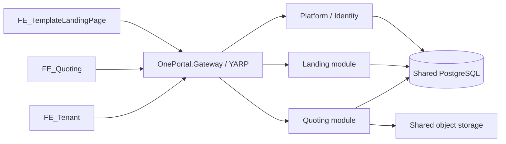

# OnePortal: multi-tenancy và vận hành

## Mô hình hiện tại

Một công ty/workspace là một `Tenant`. Tenant có thể bật `landing`, `quoting`, hoặc cả hai. Một tài khoản có nhiều membership `(TenantId, AppKey, UserId)`, mỗi membership có vai trò Admin/User và trạng thái riêng. `PlatformAdmin` quản lý nền tảng qua `FE_Tenant`; quyền này không tự cấp quyền đọc dữ liệu nghiệp vụ của mọi tenant.



P/L/Q hiện chạy trong **một OnePortal API**, deploy một backend. Gateway là executable độc lập và không reference project nghiệp vụ/DB. Đây là nền tảng modular monolith; chưa chuyển thành microservices độc lập.

## Định tuyến và quyền

- API nghiệp vụ: `/t/{tenantKey}/api/v1/landing/...` và `/t/{tenantKey}/api/v1/quoting/...`.
- Frontend: `/t/{tenantKey}/...`; BrowserRouter dùng basename tương ứng. Chuyển workspace tải lại app để bỏ state/request cũ.
- Đăng nhập identity: `/api/v1/auth/login`; membership: `/api/v1/auth/contexts?appKey=landing|quoting&page=1`.
- Platform: `/api/v1/platform/tenants`, `/api/v1/platform/users`.
- Thành viên ứng dụng: API canonical ở trên + `/members`. Tenant Admin chỉ quản lý membership đúng tenant/app.
- Token chứng minh identity. Backend đọc trạng thái tài khoản, ứng dụng và membership hiện hành từ DB; role từ token/header không có quyền quyết định tenant.
- Đường dẫn API cũ được ghim vào `landing-default` hoặc `quoting-default`, không lấy tenant từ header. Hai workspace mặc định giữ dữ liệu cũ và vai trò cũ của tài khoản.
- Đăng ký công khai chỉ mở theo từng Landing tenant; mặc định tenant mới đóng đăng ký. Quoting không tự đăng ký. Tài khoản tồn tại được PlatformAdmin cấp membership.

Tài khoản `admin@template.com` được chọn làm PlatformAdmin lần đầu. Bootstrap dựa trên ID có sẵn, không tạo mật khẩu và không reset mật khẩu hiện tại. Không gửi thông tin đăng nhập nền tảng cho người dùng tenant.

## Data isolation

`AggregateRoot<TKey>` kế thừa `TenantEntity<TKey>`. Entity nghiệp vụ mới tự có `TenantId`; child entity cũng phải kế thừa base tenant. Identity và platform metadata chỉ được dùng base global nếu nằm trong allowlist architecture test.

`ApplicationDbContext` áp dụng tenant/app filter cùng soft-delete filter, tự gán TenantId khi thêm và chặn thay tenant hoặc ghi nhầm app. Context chưa resolve tenant không thấy/ghi được dữ liệu nghiệp vụ. Unique indexes được scope theo tenant; FK giữa dữ liệu nghiệp vụ dùng `(TenantId, Id)`. Khi truy vấn reference user toàn cục cho nghiệp vụ, phải kiểm tra membership của người được chọn. `IgnoreQueryFilters`, raw SQL và bulk update cần scope tường minh, vì có thể bỏ qua EF guard.

IndexedDB drafts, pending login action và broadcast của Landing được chia theo workspace. Dữ liệu nháp cũ chỉ được nhận vào `landing-default`. Response thuộc workspace cũ bị API client loại bỏ.

## Migration và seed tự động

CLI dùng cùng migration/seed registry với runtime:

```powershell
# Từ root; connection và bootstrap ID lấy từ secret environment.
dotnet run --project BE/src/API -- --initialize-database

# Sinh migration khi thay entity (từ BE).
dotnet ef migrations add YourChange --project src/Persistence --startup-project src/API
dotnet ef migrations has-pending-model-changes --project src/Persistence --startup-project src/API
```

Ưu tiên connection: `TEMPLATE_MIGRATION_CONNECTION_STRING`, `ConnectionStrings__MigrationConnection`, rồi `ConnectionStrings__DefaultConnection`. Migration dùng quyền DDL; runtime có thể dùng tài khoản quyền hẹp hơn.

`DatabaseInitialization__Mode`:

| Mode | Hành vi |
| --- | --- |
| Startup | Migrate và seed trước khi nhận request; mặc định Development |
| Verify | Chặn startup nếu schema hoặc seed của app Ready chưa đúng phiên bản; mặc định Production |
| Disabled | Chỉ dành cho test/tool có lifecycle DB riêng |

Production chạy initializer trong pre-deploy step, sau đó API dùng Verify. Tenant Provisioning/Failed được cách ly trả 503; không chặn restart của toàn bộ API để PlatformAdmin vẫn sửa/retry được. EF9 migration lock và advisory transaction lock serialize migration/seed trên nhiều replica. Cần chạy trên PostgreSQL endpoint/session có transaction phù hợp; không dùng transaction pooler không tương thích với DDL/session lock.

Migration `20261114080350_AddMultiTenantPlatform` tạo platform schema, hai tenant mặc định, membership từ tài khoản cũ, backfill TenantId cho 19 bảng nghiệp vụ, rồi mới áp NOT NULL/FK/index. Không có tenant mặc định ở DB cho bản ghi mới: ghi từ phiên bản API cũ sau migration sẽ lỗi. Vì vậy cần phối hợp cutover backend và frontend khi triển khai bản này, và tránh dùng backend cũ sau migration.

Seed nền tảng chạy cho cả tenant mới và tenant đã tồn tại. `SystemSeedHistory` và `TenantSeedHistory` ghi phiên bản đã chạy. Retry bỏ qua bước đã hoàn tất, giữ dữ liệu được người dùng chỉnh sửa/xóa mềm. Tenant mới có category/template/menu cơ bản cho Landing, nhóm sản phẩm Chung/template trung tính cho Quoting; không sao chép khách hàng, sản phẩm, báo giá của công ty cũ.

Thêm seed: tạo `ITenantSeedStep` ở Persistence/Initialization, có AppKey/Key/Version duy nhất, đăng ký trong `DatabaseInitializer.Steps`. Bước mới dùng version cao hơn; không sửa lịch sử seed đã phát hành để ép chạy lại. Bước seed phải idempotent, query tenant rõ ràng, giữ tombstone và không chứa dữ liệu khách hàng. Seed trong một transaction; lỗi rollback và trạng thái Failed có thể retry từ `FE_Tenant`. Các bước tương lai có dữ liệu lớn nên dùng job theo lô và checkpoint.

Bootstrap một lần bằng `Tenancy__BootstrapPlatformAdminUserId`. ID phải tồn tại và active. Lịch sử ngăn lần khởi động sau tự cấp lại quyền đã bị thu hồi. Bỏ biến này sau lần khởi tạo đầu.

## Cấu hình local

`BE/src/API/appsettings.json` là cấu hình chung không có credential. Cấu hình Supabase đang dùng đã được giữ trong `BE/src/API/appsettings.Development.json` (Git/Docker ignore). Local API dùng RSA riêng ở file này; Gateway development chỉ có public key trong file development của chính Gateway. Không commit hai file development này. Clone mới: copy `appsettings.example.json` sang `appsettings.Development.json`, cấu hình DB và RSA hoặc dùng user secrets/environment. Production luôn lấy credential/key từ secret environment.

## RSA, storage và scale

Backend ký RS256 bằng `Jwt__PrivateKeyPem`; Gateway chỉ giữ `Jwt__PublicKeyPem`. Issuer/audience phải giống nhau (`OnePortal` trong render.yaml). PEM có thể dùng newline thật hoặc `\n`. HMAC chỉ dành cho Development/test. RSA private key, DB connection, Supabase key chỉ nằm ở backend/secret environment. Đổi khóa/issuer cần rollout có chủ đích và đăng nhập lại.

Supabase product images: `tenants/{tenantId:N}/quoting/uploads/`; quotation exports: `tenants/{tenantId:N}/quoting/exports/`. API download kiểm tra tenant. Bundled catalog images là static assets dùng chung. Chỉ quoting-default được fallback đọc object/file legacy. Không sửa hoặc di chuyển object legacy bằng migration schema.

Khi chạy nhiều replica, cấu hình shared object storage cho tất cả replica. `Quoting__Storage__AllowLocalFallback=false` tránh upload/export thành công ở một replica rồi thất lạc tại replica khác. File cũ chỉ nằm trên ổ Render phải được chuyển qua shared storage riêng nếu muốn tiếp tục tải trên replica mới; phải xác minh file thực tế trước cutover. Migration schema không truy cập ổ của deployment cũ.

Gateway hiện có các cluster platform/landing/quoting trỏ cùng backend. Có thể thêm nhiều destination để load balance. Rate limit hiện theo tiến trình Gateway; nếu scale nhiều Gateway cần distributed limiter/WAF và cấu hình trusted proxy/IP phù hợp. Export concurrency hiện giới hạn 4 mỗi Gateway. Không mở backend private ra Internet; TLS kết thúc tại public edge, API nội bộ dùng HTTP.

Khi tách service: giữ contract tenant URL, thay destination cluster; tách persistence/migration/seeding và quyền DB của module được tách. Giao tiếp xuyên module qua contract/event, outbox/idempotency khi cần, tránh transaction xuyên DB. Gateway không thay thế các bước tách dữ liệu và xử lý consistency này.

## Render / Vercel

### Render Free: Gateway và API cùng một instance

`Dockerfile.render-free` chạy hai executable độc lập trong một Web Service Free: Gateway lắng nghe cổng `PORT` public; API chỉ lắng nghe `127.0.0.1:54611` trong container. `scripts/start-oneportal-render-free.sh` chạy initializer trước khi mở server, giới hạn biến môi trường của Gateway để không nhận private key/DB/storage key, và dừng container nếu một process lỗi. Health Check Path là `/health/ready`, được Gateway proxy đến API/DB.

Dùng `render-free.yaml` nếu tạo Blueprint Free mới; với service hiện hữu, đổi Dockerfile Path thành `./Dockerfile.render-free`, giữ Docker Build Context `.` và Root Directory trống. Không đặt Pre-Deploy Command trên Free. Secret/issuer/audience/CORS/storage cấu hình giống mô hình hai service; cả hai process dùng cùng một bộ public/private RSA tương ứng, nhưng Gateway chỉ nhận public key. VITE_API_BASE_URL vẫn trỏ URL public service + `/api/v1`.

Free có thể ngủ khi idle và tài nguyên 512 MB được chia cho hai process; chưa có khả năng scale độc lập. Storage phải dùng Supabase, không dựa vào ổ ephemeral. Khi chuyển sang trả phí, dùng lại Dockerfile backend/Gateway riêng và `render.yaml` bên dưới.

### Hai service độc lập

`render.yaml` khai báo private backend và public Gateway; preDeploy chạy initializer. Cấu hình private service hostname/port vào cả ba destination, DB runtime/migration, RSA, Supabase storage và ba CORS frontend origins. Pre-deploy/private service cần plan Render hỗ trợ các tính năng này. Không có deployment tự động từ task coding.

Tạo ba Vercel project với Root Directory lần lượt `FE_TemplateLandingPage`, `FE_Quoting`, `FE_Tenant`, build `npm run build`, output `dist`. Đặt `VITE_API_BASE_URL=https://<gateway>/api/v1`. Đổi Root Directory project Landing hiện tại sau rename. SPA rewrites hỗ trợ deep link `/t/{key}/...`; không rewrite API/assets sang HTML. Vite dev proxy mặc định trỏ Gateway localhost:54612.

## Kiểm thử

Unit/architecture tests bảo vệ tenant base, write guard, module boundaries và storage lifetime. Integration tests tạo database PostgreSQL riêng, chạy migration thật và API HTTP; bao gồm FK chéo tenant, quyền giả mạo, seed rollback/retry, khởi tạo đồng thời và ảnh theo tenant.

Trong mỗi frontend chạy `npm test` và `npm run build`. Chạy `node scripts/verify-frontend-architecture.mjs` từ root để chặn import source chéo app và client không scope.

Browser suite tập trung ở `FE_Tenant/e2e/multi-tenant.spec.js`, chạy cả desktop/mobile qua Gateway thật và hai API replica, với synthetic identities/database và loopback storage fixture. `scripts/start-oneportal-verification.ps1` chỉ phục vụ môi trường kiểm chứng local trong task, không dùng để khởi động production. Kết quả kiểm chứng cụ thể nằm trong `PromtAI/.codex/results/multi-tenant-20261114/RESULTS.md`.

Chạy lại E2E trên Windows/PowerShell 7, sau `npm ci` cho ba app và `npx playwright install chromium` trong `FE_Tenant`:

```powershell
# PostgreSQL local cần chạy; mặc định localhost:55432, user template_test.
# Có thể đặt ONEPORTAL_E2E_CONNECTION_STRING để dùng cổng/user local khác.
# Bắt buộc Database=oneportal_e2e. Setup chỉ cho phép host loopback.
./scripts/initialize-oneportal-verification.ps1
./scripts/start-oneportal-verification.ps1
cd FE_Tenant
npm run test:e2e
cd ..
./scripts/start-oneportal-verification.ps1 -Stop
```

Initializer **reset database disposable `oneportal_e2e`**, tạo schema/seed/tài khoản synthetic, tạo RSA test key trong thư mục ignored. Không trỏ test này vào dữ liệu cần giữ. Launcher khởi động protocol storage fixture, hai API replica và Gateway; Stop chỉ dừng PID đã ghi nhận và có command line đúng workspace. Fixture không gọi Supabase thật. `BE/tools/VerificationSeed` là test tool, không nằm trong deployment backend/Gateway.


## Quoting registration and application administration

OnePortal (`FE_Tenant`) uses a company directory and separate application tabs. Select a company, then **Quoting** or **Landing Page**, then **Người dùng → Thêm người dùng**. Create a new account and scoped membership together, or grant access to an existing account without changing its password. The global identity remains User; the selected membership can be User or Admin. The last active Admin cannot be removed or downgraded.

Under **Cấu hình**, enable the application and explicitly allow self registration when desired. Registration stays closed by default for new applications. Both application types support the setting. Existing flags are preserved; this change does not automatically open any workspace.

Quoting public signup is `/t/{tenantKey}/register`. Signup creates only a User membership for that tenant and Quoting; the user then signs in. The UI reads `GET /t/{tenantKey}/api/v1/quoting/auth/registration`. Tenant Admins can toggle registration through `PUT` to the same scoped URL. Admin UI lives at `/t/{tenantKey}/admin`, with members, registration settings, catalog and support screens. Direct Admin routes and APIs enforce the effective tenant role.

Platform member creation: `POST /api/v1/platform/tenants/{tenantId}/applications/{appKey}/members`. Scoped Admin member creation: `POST /t/{tenantKey}/api/v1/{appKey}/members`. Payload: `email`, `fullName`, `password` (8–128 characters), `role` (User/Admin). Identity and membership save atomically. Duplicate accounts return 409 and require the existing-account grant flow. Scoped routes overwrite any client-supplied tenant/app identifiers.

The workspace header is hidden on both business applications. The canonical URL still determines tenant isolation; users without a valid current membership see the workspace picker instead of business data. Workspace changes use the tenant URL; no data scope is removed.

This feature uses the existing `AllowSelfRegistration` column and membership tables. No additional schema migration or production seed modification is required.
